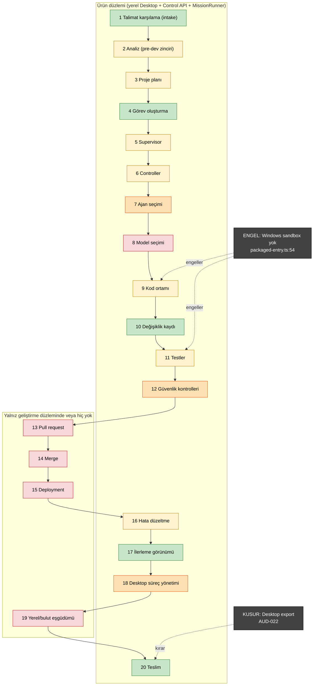

<!-- //TR: UASCO kalan iş ve kapanış raporu (kanonik) -->
# UASCO_REMAINING_WORK — Kalan İş, Operasyonel Kapanış ve Yeniden Başlatma Raporu (kanonik)

| Alan | Değer |
| --- | --- |
| Rapor kimliği / şema | UASCO_REMAINING_WORK / schemaVersion 1.0.0 (eşlik eden JSON: UASCO_REMAINING_WORK.json) |
| generatedAt | 2026-11-02T02:50:00Z (baseline çapası; kanıt penceresi 02:50Z-04:05Z) |
| integrationHead | v7/integration @ 0b71650fa88b9802968562c63ca33f8b56e9648b (merge #290, 2026-10-27T11:34:54Z); 03:50:46Z'de git ls-remote ile yeniden doğrulandı |
| Girdiler | G1-G7 denetçi raporları (eksik denetçi yok), COORD-LEDGER @afe2f9b, Master V2 WAVE0-BASELINE.json, önceki denetim v1.0 (CLAIMED) |
| Durum | KANONİK — kapanış değerleri 2026-11-02T05:30Z'de dolduruldu (COORD). Son durum: PAUSED_WITH_BLOCKERS. Bu rapor hiçbir işi başlatmaz. |
| Etiketler | VERIFIED = birincil kaynakta kontrol edildi · CLAIMED = doküman söylüyor, yeniden doğrulanmadı · ESTIMATE = çıkarım (yöntemiyle) · UNKNOWN = ölçülemedi · NOT_RUN_ENV_UNAVAILABLE = ortam yok, asla PASS değil · COORD-VERIFIED = koordinatörün 2026-11-02 doğruladığı olgu |
| Seviye merdiveni | PLANNED > DESIGNED > CODED > INTEGRATED > TESTED(unit) > VERIFIED_REAL_ENV > USABLE_BY_END_USER |
| Kimlikler | Kısaltma: metin ve tablolarda RW-### = envanter kimliği UASCO-RW-### (JSON `inventory[].id`). |

## A. Yönetici Özeti

1. **Ürün bugün hiçbir son kullanıcı tarafından kullanılamıyor (USABLE_BY_END_USER = 0, VERIFIED).** En güçlü gerçek-ortam kanıtı, imzasız Windows installer'ının GitHub runner'ında kurulup açılması (run 40497319565; EV07). Release ve tag sayısı 0.
2. **Fikir → teslim döngüsü kurulu Windows uygulamasında 'çalıştır ve doğrula' adımında kesiliyor** (G3 §2.4'teki 5 adımlı kullanıcı döngüsünün 4. adımı; E bölümündeki 20 soruluk akışta soru 9 ve 11): sandbox sağlayıcısı yok, proje kodu ve testleri hiç çalışmıyor (packaged-entry.ts:54; EV08). Desktop'taki 'Export delivery package' de ayrıca bozuk (AUD-022; EV09).
3. **Gerçek modelle ürün hattının tek kanıtı 2026-10-14 tarihli 32 saniyelik bir oyuncak çalıştırma** (EV11). Analiz, gereksinim, plan ve mimari adımları hiç gerçek modelle koşmadı. Kalan işler sahte executor'larla yalnız unit seviyesinde test edildi.
4. **Merge hattı ~136 saattir duruyor.** Açık 9 PR'dan hiçbiri merge'e hazır değil. Düzeltmeyi içermeyen her yeni CI koşusu kırmızı (11 moderate npm advisory; EV04). Düzeltme #293'te hazır ve kendi CI'ı yeşil (run 41381085868: ubuntu, windows, 3 Windows shard; installer 41381085966; EV45), ama package.json overrides için Founder yetkisi bekliyor (ledger BLOCKERS_GOV_FOUNDER_AUTHORITY, EV03; IR founder-authority job'u 41381085962 waiting).
5. **İlk PR'dan bu yana takvimin %55,2'si (211,8 / 383,9 saat) sıfır commit ile geçti.** İkinci boşluğun (134,4 h) nedeni haftalık kullanım limiti (COORD-VERIFIED, EV42); birinci boşluğun (77,4 h) nedeni repo'da kayıtlı değil (ESTIMATE: önceki haftalık pencere). İkinci aktif pencere yalnız 34 aktif saat dayandı (EV27).
6. **Maliyet (API-equivalent, faturalanan değil):** dört uzun ömürlü oturum $5.255,19. Bunun %85'i koordinatör. Token'ların %97+'sı cache-read. Merge edilen PR başına filo maliyeti $20,3; lane A/B'de $3,66-4,01 (EV23).
7. **Çıktı süreç ağırlıklı:** son 100 PR'da değişen satırların %16,1'i ürün kodu, %49,5'i CI, governance ve kanıt dosyaları (EV29). Kayıtlar bayat: BACKLOG 2026-10-20'de, queue 2026-10-22'de kalmış. 168 merged PR hiçbir görev kaydında yok (EV31).
8. **Güvenlik:** önceki 4 P0 güvenlik bulgusundan 1'i kapandı (AUD-004). 2'si açık: tek kimlik (AUD-001) ve korunmayan CI dosyaları (AUD-002). 1'i bilinmiyor: self-hosted runner (AUD-003). Trust root mühürlü ama imzasız (EV15, EV34).
9. **Kalan iş envanteri:** 87 madde (80 açık, 7 tekrar yapılmasın diye CLOSED), 254 kaynak kimliği referansı birleştirildi (248 benzersiz; 6 kimlik iki maddede birden geçiyor). Açık maddeler önceliğe göre P0 8 · P1 33 · P2 30 · P3 9.
10. **Öneri: Plan A (minimum kullanılabilir ürün).** Yeni özellik yok. Base CI yeşile döner, otomasyon bütçeye bağlanır, Windows sandbox gelir, export düzeltilir ve Founder-PC'de 3 ardışık gerçek uçtan uca çalıştırma kanıtlanır. Efor 139-385 saat (ESTIMATE). Founder'ın önce vermesi gereken kararlar J.1'in 1. sorusunda (Plan A0); önerilen ilk 10 görev K bölümünün 18. sorusunda.

## B. Operasyonel Kapanış

> Bu bölümdeki kapanış alanları 2026-11-02T05:30Z'de koordinatör tarafından dolduruldu. Baseline sütunları denetim anının (02:50Z-04:05Z) değerleridir.

| Alan | Değer |
| --- | --- |
| Kapanış zamanı | 2026-11-02T05:30Z (COORD-VERIFIED) |
| Duraklama ilan zamanı | 2026-11-02T05:17Z — controller + 3 lane tick'leri 02:27:25Z, heartbeat 05:16:43Z kapatıldı; lane'lere PAUSED bildirimi 05:17Z teslim edildi ve 3 lane de 05:17:3x-44Z'de turunu bitirip IDLE oldu (list_events, VERIFIED) |
| Kapanıştaki integration head / CI | 0b71650fa88b (değişmedi; VERIFIED git ls-remote) / son push CI 40497319498 success (2026-10-27); aynı head'de yeni bir koşu dependency-supply-chain adımında kırmızı olur (yerel npm audit 11 moderate, VERIFIED) — #293 merge edilene kadar |
| Kapanışta yapılan merge'ler | 0 (kapanış sırasında hiçbir PR merge edilmedi; VERIFIED) |
| Ledger head / kayıt | 2e92b36 (uasco/production-queue; kapanış kayıtları 47d46b0, 3074ec2, afe2f9b, f3ebe94, 2e92b36) / 129 review / 54 PR @2e92b36 |
| Rapor yayını (branch / PR / merge SHA) | uasco/production-reports → docs/closure/uasco-remaining-work/ (CI'sız rapor dalı, hemen erişilebilir) + claude/coord-closure-report-2026-11-02 → v7/integration / #__REPORT_PR__ (v7/integration'a) / Merge edilmedi — PR'ın required check'i base-wide dependency audit nedeniyle kırmızı kalır; #293 merge edildikten sonra merge edilebilir (REQUIRES_EXTERNAL_ACTION). Kanonik kopya uasco/production-reports dalında yayında. |
| Ana checkout geri yükleme | /home/user/UNIVERSAL-AI-SOFTWARE-FACTORY- → v6/pkg-t4-powershell-safety-and-verifier-differential-4js0ph dalına geri alındı (çalışma ağacı temiz; denetim sırasında detached 0b71650'deydi) |
| Founder'ın tamamladığı aksiyonlar | Kapanış süresince Founder aksiyonu yok (bekleyenler: K.1 ve Q19) |
| Yeniden başlatma (rollback) planı | K.1 tablosu (trigger bazında update_trigger enabled=true veya Founder'ın claude.ai/code/routines ekranı) + K.2 yeniden başlatma adımları (öneri: kapatılan trigger'lar update_trigger enabled=true ile, ancak Plan A0 kararlarından sonra) |
| Notlar | Sıra: PR/test/merge kapanışı → denetim (G1-G8) → envanter/planlar → duraklatma aksiyonları (05:16-05:17Z) → rapor doldurma ve yayın → son kontrol. Duraklatma aksiyonları rapor yayından hemen önce yapıldı ki rapor son durumu yansıtsın. Kapanışta yeni geliştirme başlatılmadı; yalnız base-wide CI düzeltmesi #293 (Aşama 3 kapsamında) açıldı. |

**B.1 Açık PR'lar**

| PR | Konu | Head (~04:02Z) | Baseline durumu | Envanter | Kapanış |
| --- | --- | --- | --- | --- | --- |
| #293 | COORD dep fix (glob/minimatch overrides) | ee2facb | Açık, draft değil; CI yeşil (41381085868, installer 41381085966); ledger BLOCKERS_GOV_FOUNDER_AUTHORITY; founder-authority job waiting (41381085962) | RW-001 | REQUIRES_EXTERNAL_ACTION — CI tamamen yeşil (41381085868; installer 41381085966); kod hatası yok (review wf_c700d6f5-f24, 5 LOW); yönetişim engeli: package.json overrides protectedField + CI_EXECUTED_FLOOR (ledger afe2f9b). Founder: founder-authority environment onayı (run 41381085962) + protected merge. PR yorumu 6568245662. |
| #292 | Lane A A2 tools panel | 43776e1 | Delta NO_BLOCKERS; CI base-wide kırmızı | RW-042 | BLOCKED — delta NO_BLOCKERS (47d46b0), merge-gate açık; required check validate (ubuntu-latest) base-wide audit nedeniyle kırmızı (41377356505). Sonraki adım: #293 merge → update-branch → base-merge delta kaydı → auto-merge → post-merge doğrulama. |
| #291 | Lane B B2 role context | 4b4eee0 | Draft; full NO_BLOCKERS 4 LOW | RW-043 | BLOCKED — full NO_BLOCKERS 4 LOW (3074ec2, wf_10d5501d-ffb), merge-gate açık; draft ve base'in gerisinde; #293 bekliyor. Sonraki adım: #293 → ready-for-review → update-branch → CI → merge. |
| #288 | Lane C C-RDY-2b | 7bf22e5 | Draft; BLOCKERS 2M+14L @73fa26e; onarım push'u ~04:01Z | RW-076 | BLOCKED — repair 7bf22e5 delta NO_BLOCKERS 6 LOW (f3ebe94, wf_1c7042cf-8eb; 85/85 mutant öldü), merge-gate açık; draft; CI 41386006766 yalnız dependency-supply-chain'de kırmızı (base-wide); #293 bekliyor. |
| #282 | Lane C PAR03 diag | b13e23d | Draft; delta BLOCKERS 1M+2L; round-3 push | RW-044 | BLOCKED — TEP-1 son tur (r3) delta NO_BLOCKERS 6 LOW (2e92b36, wf_f07380b4-f35), merge-gate açık; draft; CI 41383416275 kırmızı (dependency-supply-chain base-wide; Windows aggregator'daki MODULE_NOT_FOUND ci-evidence.mjs nedeni kurulmadı); #293 bekliyor. LOW: yeni gap-binding testinde 5 ms pay (Windows flake riski) ve bir test timeout'u 60→120 s. |
| #251 | COORD protected CI-TEP1 | f40bea3 | Draft; Founder-held; dirty | RW-012 | REQUIRES_EXTERNAL_ACTION — Founder-held protected CI-TEP1; dirty; kapanışta dokunulmadı |
| #247 | COORD protected aut2 tmp cleanup | 323c14f | Draft; Founder-tier; dirty | RW-012 | REQUIRES_EXTERNAL_ACTION — Founder-tier protected (aut2 tmp cleanup + reseal); dirty; kapanışta dokunulmadı |
| #231 | Lane B+C WSL2 sandbox | c9a3e2d | Draft; Founder-tier; dirty; 9 review head | RW-004 | REQUIRES_EXTERNAL_ACTION — Founder-tier WSL2 sandbox (RW-004); dirty; kapanışta dokunulmadı |
| #66 | E2E desktop verify | ffeaf79 | Draft; Founder-held (2026-10-20'den beri) | RW-012 | REQUIRES_EXTERNAL_ACTION — Founder-held (2026-10-20'den beri); kapanışta dokunulmadı |

**B.2 Trigger ve rutinler**

| Rutin | Id | Takvim | Baseline | Kapanış |
| --- | --- | --- | --- | --- |
| Controller tick | trig_01Ln2KUz671sAXXmAUu6tVm4 | 41 * * * * | Kapatıldı 02:27Z (COORD) | KAPALI — enabled=false (02:27:25Z, COORD); list_triggers 05:2xZ VERIFIED |
| Lane A tick | trig_01BMrSHJzf85secZCW2jKJsc | 13 * * * * | Kapatıldı 02:27Z | KAPALI — enabled=false (02:27:25Z); VERIFIED |
| Lane B tick | trig_01XN7KFTiR6oXtEH81drD9wP | 33 * * * * | Kapatıldı 02:27Z | KAPALI — enabled=false (02:27:25Z); VERIFIED |
| Lane C tick | trig_01LtND1PCR7XXvaxFewc2Eas | 53 * * * * | Kapatıldı 02:27Z | KAPALI — enabled=false (02:27:25Z); VERIFIED |
| Heartbeat | trig_01QEwrSwCvd8UCbKFn97MiHh | 11 */3 * * * | ETKİN; 03:11:26Z ateşledi; agent kapatabilir | KAPALI — enabled=false (05:16:43Z, COORD); son rapor 52e826c @03:12Z; VERIFIED |
| Independent Cloud Reviewer | trig_01NJCi2PSTJxh6rMMLewLvGM | 38 * * * * | ETKİN; 02:38:39Z ve 03:39:10Z'de ateşledi (list_triggers 04:28Z); http_api (yalnız Founder) | ETKİN (DURDURULAMADI) — http_api ile oluşturulmuş; agent'ın update_trigger isteği reddedildi (05:16Z). Saatlik read-only reviewer; son ateşleme 04:38:33Z (~47 sn). Founder kapatmalı: https://claude.ai/code/routines/trig_01NJCi2PSTJxh6rMMLewLvGM |
| UASCO Cloud Development | trig_018vLbG82sUcp6ncPhRurka5 | 29 * * * * (Sonnet 5.5) | ETKİN; 02:29:54Z ve 03:29:53Z'de ateşledi (list_triggers 04:28Z); http_api (yalnız Founder) | ETKİN (DURDURULAMADI) — http_api ile oluşturulmuş; agent'ın update_trigger isteği reddedildi (02:27Z). Saatlik builder (Sonnet 5.5, taze oturum); son ateşleme 04:29:42Z (~30 sn çalıştı; yeni branch/PR/commit gözlenmedi, VERIFIED git ls-remote + PR listesi). Founder kapatmalı: https://claude.ai/code/routines/trig_018vLbG82sUcp6ncPhRurka5 |
| Safety-net one-shot | trig_0137JfTiMWXAbqVQNaPSMVmF | 2026-11-02T03:56Z | 03:56:44Z'de ateşledi; enabled=false, ended_reason run_once_fired (get_trigger 04:28Z, VERIFIED) | KAPALI — run_once_fired 03:56:44Z; VERIFIED |
| Production Builder x2, PR #11 safety-net, probe | trig_01HJfvsZ..., trig_01BiCMim..., trig_01EJnVSL..., trig_017MW7Ln... | - | Önceden kapalı | KAPALI — değişmedi; VERIFIED |

| Lane oturumu | Baseline | Kapanış |
| --- | --- | --- |
| Lane A session_01MApoJPisUKhZdWpTJmcnY3 | idle; yalnız #292 (ACK) | IDLE — PAUSED bildirimi 05:17Z alındı, tur 05:17:44Z bitti (list_events VERIFIED); açık: #292; branch-only claude/lane-a-tools-panel-a2b @ce09d00 dokunulmadı |
| Lane B session_01VaHcvhtW9yjHAsFktdTn5f | idle; #291 + #231 dondu (ACK) | IDLE — PAUSED bildirimi alındı, tur 05:17:42Z bitti (VERIFIED); açık: #291, #231 |
| Lane C session_01Vf5LYEF7vPGkRwL6X5AeGT | ~03:21Z RUNNING (G6); #282 b13e23d ve #288 7bf22e5 pushladı; eval-tester mutasyon koşusu (RW-045); 04:02Z'den beri IDLE (get_session 04:28Z) | IDLE — PAUSED bildirimi alındı, tur 05:17:31Z bitti (VERIFIED); #282 b13e23d ve #288 7bf22e5 son push'ları; yerel worktree'ler korunuyor |
| Actions kuyruğu / takılı IR run | ~02:55Z (G1): 0 queued, 0 in_progress, 1 waiting (39687649214). 04:27Z: 0 queued, 1 in_progress (CI 41386006766, #288), 2 waiting (39687649214; 41381085962 #293 founder-authority) (EV46) | 0 queued / 0 in_progress / 2 waiting (05:2xZ, status filtreli actions_list VERIFIED) / 39687649214 (2026-10-21'den beri waiting, founder-authority) + 41381085962 (#293 founder-authority) — ikisi de Founder environment onayı bekliyor; dokunulmadı |
| Heartbeat raporu | 52e826ce @03:12:19Z (uasco/production-reports) | Son rapor 52e826c @03:12Z; heartbeat 05:16:43Z'de kapatıldı |

## C. Ürün Hazırlığı

| Modül | Ad | Kanıtlanmış en yüksek seviye | Son kullanıcı? | Ana engel | Kaynak |
| --- | --- | --- | --- | --- | --- |
| A | Masaüstü | VERIFIED_REAL_ENV yalnız CI installer smoke; ekranlar INTEGRATED + TESTED(unit) | Hayır | Sandbox yok, export kırık, imzasız, Founder-PC kaydı yok | G3 |
| B | Yazılım fabrikası | TESTED(unit) (sahte builder/executor); 1 oyuncak canlı run (UNVERIFIABLE) | Hayır | Windows sandbox; gerçek-model çalıştırma yok; 3 basit şablon | G4 |
| C | Orkestrasyon | INTEGRATED + TESTED(unit) tek runner; crew CODED, bağlı değil | Hayır | Crew/paralel çalışma zamanı yok | G5 |
| D | Model/sağlayıcı | INTEGRATED: tek sağlayıcı (Claude CLI) | Hayır | Routing/metering/failover yok | G5 |
| E | QA ve güvenlik | TESTED(unit); UASCO'nun kendi CI'ı gerçek | Hayır (müşteri ürünü olarak) | Gerçek araçlar yalnız sahte binary ile; SAST yok | G4 |
| F | Mobil Companion | DESIGNED + TESTED(unit, local) çekirdek | Hayır | Uygulama, gateway, Founder kararları yok | G3 |

- **Masaüstü (A1-A22, G3):** 6 satır VERIFIED_REAL_ENV seviyesinde, ama yalnız GitHub CI runner'ında: build, kurulum, kaldırma, başlatma, yerel çalışma. Yaklaşık 10 satır INTEGRATED + TESTED(unit). 5 satır PLANNED ya da NOT_IMPLEMENTED: otomatik güncelleme, komut alanı UI'ı, ses, akıllı revizyon, uzak çalışma. Renderer'daki 73 /v1 yolunun 73'ü kayıtlı route'lara bağlı (VERIFIED). 23 route'un 10'u yalnız fake bridge ile test ediliyor.
- **Fabrika (B1-B16, G4):** 10 yetenek TESTED(unit), 4'ü DESIGNED (DevOps, CI/CD, deploy, izleme), 1'i PLANNED (admin/CMS). Müşteri için mobil yetenek yalnız DESIGNED; mevcut tek mobil kod UASCO'nun kendi Companion çekirdeği. Ürünün bugün üretebildiği tek şey: kaynak ağacı + pre-dev dokümanları + statik tarama + ikinci Claude review'u + 'tests NOT EXECUTED' etiketli ZIP.
- **Mobil (F1-F13, G3):** 11 DESIGNED, 1 CODED + TESTED(unit, local; CI'da değil), 1 NOT_APPLICABLE. INTEGRATED olan hiçbir şey yok.
- **Gerçek ortam testleri:** Bu denetimde hiçbir test suite'i koşulmadı. Sandbox/netns, Windows ve Electron testleri NOT_RUN_ENV_UNAVAILABLE. Koordinatörün tam suite sonucu (3251 pass / 10 fail / 24 skip) CLAIMED olarak alındı (EV40).

## D. Kalan İş (önceliklendirilmiş envanter)

Toplam 87 madde: 80 açık ve 7 CLOSED (izlenebilirlik için; yeniden yapılmaz). Duruma göre: BLOCKED 24, OPEN 53, UNKNOWN 3, CLOSED 7. Plana göre: A 28, B 30, C 17, DEFER 5, DONE 7. Her maddenin tam alanları (description, completionCriteria, links, risk, needs, testNeeds, verificationMethod, mergedFrom; çekirdeği zaten merge edilmiş 5 maddede ayrıca alreadyDoneDoNotRedo: RW-004, RW-013, RW-025, RW-036, RW-061) JSON dosyasındaki `inventory` dizisinde. Mükerrerler birleştirildi; kaynak kimlikleri `mergedFrom` alanında korunuyor (254 referans, 248 benzersiz kimlik). Tekrar kontrolü: açık maddeler G2'nin DONE kayıtlarına ve merged PR başlıklarına karşı tarandı. Çekirdeği zaten merge edilmiş maddeler (#134, #130, #168/#184/#227 gibi) yalnız bağlama/uzatma işi olarak tanımlandı.

| ID | Ad (tam ad JSON'da) | Mod. | Önc. | Durum | Bağımlılık (RW-) | Efor saat (E) | Plan |
| --- | --- | --- | --- | --- | --- | --- | --- |
| RW-001 | Base-wide dependency audit kırmızısını kapat (#293) | CI | P0 | BLOCKED | - | S 1-4 | A |
| RW-002 | http_api rutinlerini kapat: UASCO Cloud Development ve … | OPS | P0 | BLOCKED | - | S 0,25-0,5 | A |
| RW-003 | Kullanım bütçesi ve USAGE_LIMIT davranışı (yeniden başlatma … | OPS | P0 | OPEN | 002,017 | M 6-16 | A |
| RW-004 | Windows sandbox sağlayıcısı (#231 WSL2): kurulu uygulamada … | B | P0 | BLOCKED | 001 | XL 40-120 | A |
| RW-005 | İlk gerçek uçtan uca çalıştırma (fikir → teslim) Founder-PC'de | B | P0 | BLOCKED | 004,009,010,011 | L 16-40 | A |
| RW-006 | Korunan yol kapsamını genişlet + trust-root reseal … | GOV | P0 | BLOCKED | - | M 4-10 | A |
| RW-007 | Self-hosted runner DESKTOP-G4U0679 kontrolü ve kaldırılması … | GOV | P0 | UNKNOWN | - | S 0,25-0,5 | A |
| RW-008 | Builder/reviewer/merger kimlik ayrımı ve ruleset … | GOV | P0 | BLOCKED | 023 | M 4-12 | B |
| RW-009 | Desktop 'Export delivery package' her zaman başarısız … | A | P1 | OPEN | 001,006 | S 3-8 | A |
| RW-010 | Paketli uygulamada PATH ve Claude CLI keşfi (AUD-115) | A | P1 | UNKNOWN | 011 | S 2-8 | A |
| RW-011 | Founder-PC installer pilotu (0.7.0-dev.3) | A | P1 | BLOCKED | 001 | S 2-6 | A |
| RW-012 | Founder-held PR kararları: #66, #247, #251 | GOV | P1 | BLOCKED | 001 | S 1-4 | A |
| RW-013 | Windows CI kararlılığı (FD-LV1 kalıntı grant, timing … | CI | P1 | BLOCKED | 001 | L 16-40 | A |
| RW-014 | Tek, makine-okunur görev kaydı (merge'lerden beslenen) | OPS | P1 | OPEN | 015 | M 12-30 | A |
| RW-015 | Tek yetkili roadmap ilan et; diğer planları arşivle | GOV | P1 | OPEN | - | S 2-6 | A |
| RW-016 | Kapsam kararı: v1 = yalnız kaynak teslimi mi, … | B | P1 | OPEN | 015 | S 0,5-2 | A |
| RW-017 | Koordinatör oturumunu yeniden şekillendir: periyodik taze … | OPS | P1 | OPEN | - | M 6-16 | A |
| RW-018 | Dev-plane maliyet/token telemetrisi ve bütçe uygulaması | OPS | P1 | OPEN | - | M 6-16 | A |
| RW-019 | Heartbeat rutini: kapat veya günlüğe indir | OPS | P1 | OPEN | - | S 0,25-1 | A |
| RW-020 | Rutin prompt'larını repo'da sürümle (AUD-018) | GOV | P1 | OPEN | - | S 2-6 | A |
| RW-021 | Repo görünürlüğü ve CI bütçesi kararı | GOV | P1 | OPEN | - | S 0,25-1 | A |
| RW-022 | İmzalı sürüm kanalı: code-signing, Release workflow, … | CI | P1 | BLOCKED | 001,006 | L 16-40 | B |
| RW-023 | Independent Review bootstrap, reviewer kimliği/OAuth … | GOV | P1 | BLOCKED | - | M 4-12 | B |
| RW-024 | Gerçek Electron desktop journey E2E'yi Windows CI'a ekle | CI | P1 | BLOCKED | 001,006 | M 8-24 | B |
| RW-025 | Tek komut alanı: command-intake çekirdeğini Desktop'a bağla | A | P1 | OPEN | 005 | M 8-24 | B |
| RW-026 | Pre-dev çıktı kalitesi ve ilk rol değerlendirmeleri (FD-2, … | B | P1 | BLOCKED | 005 | L 16-40 | B |
| RW-027 | Müşteri stack kapsamı: gerçek scaffold ve araç zincirleri | B | P1 | OPEN | 005 | XL 40-120 | B |
| RW-028 | Action-gateway: sabit ALLOW politika bağlamını gerçek … | E | P1 | OPEN | 032 | M 12-30 | B |
| RW-029 | Trust root'u repo dışı anahtarla imzala (AUD-007) | E | P1 | BLOCKED | 006 | M 8-20 | B |
| RW-030 | PR ile eklenen vitest/vite config'in CI'ı boş yeşile … | E | P1 | OPEN | 006 | S 3-8 | B |
| RW-031 | Gerçek SAST + gerçek gitleaks/trivy CI'da (FD-8) | E | P1 | BLOCKED | 006 | M 12-30 | B |
| RW-032 | Ürün içinde token/maliyet ölçümü ve bütçe uygulaması | D | P1 | OPEN | - | M 12-30 | B |
| RW-033 | Crew/team katmanı için çalışma zamanı sürücüsü | C | P1 | OPEN | 005,055 | XL 60-160 | C |
| RW-034 | Sub-agent/paralel çalışma ve otomatik görev dağıtımı | C | P1 | OPEN | 033 | XL 60-160 | C |
| RW-035 | Yerel+bulut eşzamanlılığı: FA-LEASE2 yetkili lease, lease … | C | P1 | BLOCKED | - | XL 40-120 | C |
| RW-036 | Model yönlendirme (routeModel/chooseProvider) ve Desktop … | D | P1 | OPEN | 032 | L 24-60 | C |
| RW-037 | Sağlayıcı failover, ikinci sağlayıcı ve yerel/ücretsiz … | D | P1 | OPEN | 036 | XL 60-160 | C |
| RW-038 | Mobil Founder kararları FA-MOB-1..23 ve MOB-11..31 yetkisi | F | P1 | BLOCKED | 015 | S 2-6 | C |
| RW-039 | Mobil Companion uygulaması (React Native/Android, APK, … | F | P1 | OPEN | 038,040 | XL 120-300 | C |
| RW-040 | /v1/mobile/* route'ları, eşleştirme ve telefona … | F | P1 | OPEN | 038,028 | XL 60-160 | C |
| RW-041 | Uzaktan onay ve STOP için onay-attestation sertleştirme | F | P1 | OPEN | 028,040 | L 24-60 | C |
| RW-042 | #292 (A2 tools panel): dep fix sonrası güncelle ve merge et | A | P2 | BLOCKED | 001 | S 1-3 | A |
| RW-043 | #291 (B2 role context route): draft'tan çıkar, güncelle, … | C | P2 | BLOCKED | 001 | S 1-3 | A |
| RW-044 | #282 (PAR03 diag): round-3 delta review (b13e23d) ve son karar | CI | P2 | OPEN | 001 | S 1-4 | A |
| RW-045 | Lane C dondurma kapsamı: claude/lane-c-eval-tester … | OPS | P2 | UNKNOWN | - | S 0,5-2 | A |
| RW-046 | Saatlik tick yerine olay güdümlü uyanma + hatırlatıcı hijyeni | OPS | P2 | OPEN | 003 | M 6-16 | A |
| RW-047 | Founder kuyruğu ve yetki talepleri için sahip/son … | GOV | P2 | OPEN | 014 | S 4-8 | A |
| RW-048 | Süresi dolan CI kanıtlarının özetlerini koru (zaman kritik) | OPS | P2 | OPEN | - | S 3-8 | A |
| RW-049 | Ürün/meta dengesi ve LOW bulgu toplama kuralı | OPS | P2 | OPEN | - | S 2-6 | A |
| RW-050 | Güncelleme ve geri alma yolu (AUD-081) | A | P2 | OPEN | 022 | L 16-40 | B |
| RW-051 | Paketli backend yaşam döngüsü: crash/restart, IPC timeout | A | P2 | OPEN | - | M 8-20 | B |
| RW-052 | Electron kod bütünlüğü: fuses, asar, debug switch'leri, … | A | P2 | OPEN | - | M 8-24 | B |
| RW-053 | 10 fake-bridge route için renderer→real-server testleri | A | P2 | OPEN | - | M 12-30 | B |
| RW-054 | Müşteri teslim kanalı: müşteri repo'suna push/PR | B | P2 | OPEN | 005,016 | L 24-60 | B |
| RW-055 | Daha fazla rolü çalışma zamanı aşamalarına bağla (9/599) | C | P2 | OPEN | 026 | L 24-60 | B |
| RW-056 | core/qa/api validator'larını üretime bağla veya kaldır … | E | P2 | OPEN | - | S 4-10 | B |
| RW-057 | Run başına duraklatma/devam ve BLOCKED run kurtarma | C | P2 | OPEN | - | L 24-60 | B |
| RW-058 | Yerel Windows test worker (PR #190) Founder-PC pilotu | CI | P2 | BLOCKED | 011 | M 8-20 | B |
| RW-059 | Dev-plane mantığını ve V6 supervisor yüzeylerini ürün … | C | P2 | OPEN | - | M 8-20 | B |
| RW-060 | Dört üst üste binen review mekanizmasını tek yönetilen yola … | OPS | P2 | OPEN | 002,023 | M 6-16 | B |
| RW-061 | CI dakika verimliliği | CI | P2 | OPEN | 012,013 | M 6-16 | B |
| RW-062 | Dependabot, secret scanning, code scanning ve git geçmişi … | E | P2 | BLOCKED | - | S 2-6 | B |
| RW-063 | Alpha electron-builder 27.0.0-alpha.9'u kararlı sürümle … | CI | P2 | OPEN | 001 | M 4-12 | B |
| RW-064 | apps/mobile/src/core/monitoring.test.ts dosyasını CI'a kaydet | F | P2 | BLOCKED | 006 | S 0,5-2 | B |
| RW-065 | git-isolation merkezi fsmonitor/untrackedCache yetki talebi | GOV | P2 | BLOCKED | 006 | S 2-6 | B |
| RW-066 | 252 ekran anahtarını yeniden sınıfla (147 BLOCKED) | A | P2 | OPEN | 014 | M 6-16 | B |
| RW-067 | Akıllı revizyon (UI-015) | A | P2 | OPEN | 005,025 | L 24-60 | C |
| RW-068 | Masaüstü ikincil yetenekler: OS bildirimi, rapor dışa … | A | P2 | OPEN | 009 | XL 60-160 | C |
| RW-069 | Müşteri projesi için CI/CD, deploy ve izleme üretimi | B | P2 | OPEN | 016,054 | XL 120-300 | C |
| RW-070 | Dokümantasyon üretimi (API docs, kullanıcı kılavuzu, … | B | P2 | OPEN | 005 | L 24-60 | C |
| RW-071 | Mobil güvenlik koşulları, RN sertifikasyonu ve ileri … | F | P2 | OPEN | 039 | XL 60-160 | C |
| RW-072 | Oturum, branch ve workflow hijyeni | OPS | P3 | OPEN | - | S 3-8 | B |
| RW-073 | Masaüstü ses girişi | A | P3 | OPEN | 025 | L 24-60 | C |
| RW-074 | Yerel veri şifreleme ve anahtarlı journal anchor | E | P3 | OPEN | 052 | L 24-60 | C |
| RW-075 | Implementer/reviewer Claude CLI süreçlerini de sandbox'ta … | E | P3 | OPEN | 004 | L 24-60 | C |
| RW-076 | #288 (C-RDY-2b): 2M+14L onarımı veya park | C | P3 | OPEN | - | M 4-12 | DEFER |
| RW-077 | Master V2 Lane-C kalan paketleri (C-CTX-2, C-EVAL-2, … | C | P3 | OPEN | 015 | XL 60-160 | DEFER |
| RW-078 | Master V2 cross-lane kalanlar (A3, B3, B4, Z1, Z2, Z3) | C | P3 | OPEN | 014 | L 24-60 | DEFER |
| RW-079 | Master V2 Founder kararları (FD-1, FD-4, FD-5, FD-6 spec … | GOV | P3 | BLOCKED | 015 | S 2-6 | DEFER |
| RW-080 | Registry genişliği programı (599 rol, 425 skill, 415 … | B | P3 | OPEN | 026 | XL 200-600 | DEFER |

CLOSED (izlenebilirlik; yeniden yapılmaz): RW-081 AUD-004: Control API percent-encoded /v1 token bypass düzeltildi · RW-082 Windows installer CI build + sessiz kurulum/başlatma/onarım/kaldırma smoke · RW-083 Master V2 merge edilenler: C-RDY-1 #260, C-CTX-1 #265+#289, C-RDY-2a #264, B1 #262, A1 #263, A4 #261 · RW-084 Android Phase 0 tasarım dokümanları MOB-1..9 ve saf TS izleme çekirdeği (PQ-008 #159) · RW-085 Linux unshare sandbox sağlayıcısı ve doğrulanmış sandbox'ta ürün çalıştırma (Linux) · RW-086 Kaynak teslim ZIP'i (sunucu tarafı) + export secret-scan bloğu · RW-087 Command-intake çekirdeği (PQ-011 #134) ve model routing çekirdeği (PQ-010 #130).

**D.2 Epic > Feature > Task yol haritası (yeniden kurgu).** Durum kuralı: görev COMPLETE = merge + kendi kapsamında CI testi. Özellik COMPLETE = gerçek ortamda doğrulanmış. Epic COMPLETE = son kullanıcı kanıtı. Planlanmış ya da kodlanmış olmak COMPLETE sayılmaz.

Epic 9 (hiçbiri COMPLETE) · Feature 49 (PARTIAL 24, BLOCKED 8, MISSING 16, UNVERIFIABLE 1) · Task 129 (COMPLETE 36, BLOCKED 23, UNVERIFIABLE 6, MISSING 57, PARTIAL 7). G8 düzeltmesi: UASCO-T0080 (mobil çekirdek, testi CI'da değil) ve UASCO-T0094 (desktop journey harness, CI'da koşmuyor) COMPLETE → PARTIAL.

Epic'ler: UASCO-E01 Masaüstü uygulaması (A, PARTIAL) · UASCO-E02 Yazılım fabrikası hattı (B, PARTIAL) · UASCO-E03 Çok ajanlı orkestrasyon (C, PARTIAL) · UASCO-E04 Model ve sağlayıcı yönetimi (D, PARTIAL) · UASCO-E05 QA ve güvenlik platformu (E, PARTIAL) · UASCO-E06 Mobil Companion (F, PARTIAL) · UASCO-E07 CI, yayın ve dağıtım (CI, PARTIAL) · UASCO-E08 Yönetişim ve Founder yetkisi (GOV, BLOCKED) · UASCO-E09 Geliştirme operasyonları ve kayıtlar (OPS, PARTIAL).

| Epic/Feature | Durum | Kanıtlanmış seviye |
| --- | --- | --- |
| E01/F001 Electron kabuğu + paketli backend başlatma | PARTIAL | VERIFIED_REAL_ENV (yalnız CI runner) |
| E01/F002 UI kabuğu, 23 route, renderer → Control API bağlantısı | PARTIAL | INTEGRATED + TESTED(unit) |
| E01/F003 Intake ve tek komut alanı | PARTIAL | INTEGRATED + TESTED(unit) (form); komut alanı PLANNED |
| E01/F004 Görev/plan/çalıştırma ekranları (Work, Studio, pre-dev kararları) | PARTIAL | INTEGRATED + TESTED(unit); Linux Electron CLAIMED |
| E01/F005 Teslim kartı ve dışa aktarma | BLOCKED | CODED, Desktop export kırık |
| E01/F006 Akıllı revizyon | MISSING | PLANNED |
| E01/F007 Ses girişi | MISSING | PLANNED |
| E01/F008 Bildirimler ve raporlar | PARTIAL | INTEGRATED (in-app) |
| E01/F009 Masaüstü güvenlik sertleştirmesi | PARTIAL | TESTED(unit) + kısmen VERIFIED_REAL_ENV (CI) |
| E01/F010 Güncelleme ve geri alma | MISSING | PLANNED (manuel NSIS hook CODED) |
| E02/F011 Pre-dev zinciri (BA, Requirements, Plan, Architecture, UxSpec) | PARTIAL | TESTED(unit), sahte builder |
| E02/F012 Implement + review runner (7 adım) | PARTIAL | INTEGRATED + TESTED(unit); bir kez canlı (2026-10-14) |
| E02/F013 Sandbox'ta test yürütme | BLOCKED | Linux: CODED + CI; Windows: yok |
| E02/F014 Güvenlik aşaması | PARTIAL | TESTED(unit), sahte binary |
| E02/F015 Kaynak teslimi ve kabul | PARTIAL | INTEGRATED + TESTED(unit) |
| E02/F016 Müşteri stack ve şablonları | MISSING | 3 basit Node şablonu |
| E02/F017 Müşteri PR / merge / deploy | MISSING | PLANNED |
| E02/F018 Dokümantasyon üretimi | MISSING | DESIGNED (registry) |
| E03/F019 Tek mission runner (lease, fencing, retry) | PARTIAL | INTEGRATED + TESTED(unit) |
| E03/F020 Crew/team çalışma zamanı | MISSING | CODED + TESTED(unit), bağlı değil |
| E03/F021 Paralel/sub-agent çalışma ve görev dağıtımı | MISSING | yok |
| E03/F022 Duraklatma, devam, kurtarma | PARTIAL | GLOBAL_STOP INTEGRATED |
| E03/F023 Yerel + bulut lease (FA-LEASE2) | BLOCKED | CODED, bağlı değil |
| E03/F024 Rol bağlama ve hazırlık ölçümü (Master V2) | PARTIAL | 9 rol bağlı; 6/21 V2 maddesi merge |
| E04/F025 Claude CLI executor çifti (iki profil) | PARTIAL | INTEGRATED; paketli uygulamada UNKNOWN |
| E04/F026 Model yönlendirme | MISSING | CODED çekirdek, bağlı değil |
| E04/F027 Token/maliyet ölçümü | MISSING | yok |
| E04/F028 Failover, ikinci sağlayıcı, yerel model | MISSING | DESIGNED (OmniRoute yalnız keşif) |
| E05/F029 Test-surface bütünlük koruması | PARTIAL | INTEGRATED + TESTED(unit) |
| E05/F030 Trust root ve korunan yollar | PARTIAL | SEALED (373 dosya), imzasız |
| E05/F031 Kimlik ayrımı ve ruleset | BLOCKED | yok (0 onay) |
| E05/F032 Action-gateway politikası | PARTIAL | INTEGRATED, sabit ALLOW |
| E05/F033 Bağımlılık tedarik zinciri kapısı | PARTIAL | Kapı çalışıyor; base kırmızı |
| E05/F034 Repo güvenlik taraması | MISSING | kapalı |
| E06/F035 Mobil tasarım paketi ve salt-okur çekirdek | PARTIAL | DESIGNED + TESTED(unit, local) |
| E06/F036 Mobil uygulama ve gateway | MISSING | DESIGNED |
| E06/F037 Uzaktan onay ve STOP | BLOCKED | DESIGNED |
| E07/F038 CI hattı (ubuntu + 3 Windows shard + aggregator) | PARTIAL | Çalışıyor; şu an base-wide kırmızı; flaky |
| E07/F039 Windows installer build | PARTIAL | VERIFIED_REAL_ENV (CI); release yok |
| E07/F040 İmzalı sürüm | BLOCKED | yok |
| E07/F041 Windows desktop E2E CI | BLOCKED | Linux harness CLAIMED |
| E08/F042 Bağımsız review yolu | BLOCKED | Workflow canlı, ai-review skipped |
| E08/F043 Founder yetki kaydı ve kararlar | PARTIAL | Serbest metin |
| E08/F044 Self-hosted runner hijyeni | UNVERIFIABLE | UNKNOWN (API 403) |
| E09/F045 Dev-plane orkestrasyonu (koordinatör, lane'ler, ledger, dispatch) | PARTIAL | Gerçek, günlük kullanımda; SPOF |
| E09/F046 Kota ve bütçe kontrolü | MISSING | yok |
| E09/F047 Rutin ve oturum hijyeni | PARTIAL | 4 trigger kapatıldı; 2'si Founder'da |
| E09/F048 Tek görev kaydı ve tek roadmap | MISSING | dağınık, bayat |
| E09/F049 Kanıt saklama | MISSING | artifact'lar siliniyor |

Görev listesi (129 görev; her biri feature, kanıt bağlantısı ve envanter kimliğiyle) JSON'daki `roadmap.tasks` dizisinde; kanıt sütunu `roadmap.features[].evidence` alanında.

## E. Mimari ve Akış

Üç ayrı 'orkestrasyon' düzlemi var ve birbirine karıştırılmamalı (G5 §1):

| Düzlem | Nerede | Nerede çalışır | Bugünkü durum |
| --- | --- | --- | --- |
| P — Ürün çalışma zamanı | core/workos, apps/control-api, apps/desktop | Kullanıcı PC'si, 127.0.0.1 | CODED + INTEGRATED + TESTED(unit); gerçek Claude bir kez (2026-10-14) |
| V6 — Depo içi inşa supervisor'ı | automation/, scripts/uasco-orchestrator.mjs | Founder PC (Task Scheduler) | CODED + selftest; CLOUD_MIGRATION_MANIFEST L1'e göre yerini bulut aldı; Founder PC'deki durumu UNKNOWN |
| D — Geliştirme orkestrasyonu | Bulut oturumları, rutinler, dispatch.mjs, coord-ledger.mjs, GitHub CI | Anthropic bulut + GitHub | GERÇEK; depoyu inşa eden sistem (1277 commit / 536 merge commit since 2026-10-17) |

**20 soruluk senaryo (Founder'ın Aşama 6 soruları, aynen ve sırasıyla; kaynak: Founder direktifi 2026-11-01T21:52Z):** 'Founder Desktop uygulamasına yeni bir yazılım projesi geliştirilmesi için komut giriyor.' Her satır Founder'ın istediği altı bilgiyi verir: beklenen tasarım, gerçek mevcut uygulama, ilgili kod/yapılandırma, çalışma kanıtı, eksik bileşen, risk. Kaynaklar: G5 §5 (adım tablosu; kod yolları G5'te VERIFIED, sınıflama ESTIMATE), G3 §2 (Desktop), G4 §2-3 (fabrika, güvenlik). Eşleme: G5 §5'teki ayrı 'Analysis' ve 'Requirements' adımları soru 2'de birleşti (ikisi aynı pre-dev zinciri); G5'in 19. adımı (Desktop yönetimi + yerel/bulut eşgüdümü) soru 18 ve 19 olarak ikiye ayrıldı; diğer adımlar bire bir eşlendi. G5'te ayrı adım olmadığından soru 18'in PARTIAL sınıfı G3 §2.1-2.2'den türetildi (ESTIMATE). Önceki taslaktaki sayımdan fark yalnız bu eşlemeden geliyor: REAL-code/SIM-evidence 8 → 7, PARTIAL 2 → 3.

**Sonuç (ESTIMATE):** REAL 5 · REAL-code/SIM-evidence 7 · PARTIAL 3 · PLAN 5 · SIMULATION 0 (= 20). Hiçbir soru USABLE_BY_END_USER değil. Gerçek anlamda çalışan noktalar: soru 1, 4, 10, 17, 20 (bağlı ve kendi bağımlılığına karşı test edilmiş). Yalnız sahte executor/fixture ile kanıtlananlar: 2, 3, 5, 6, 9, 11, 16. Kısmi: 7, 12, 18. Yalnız plan: 8, 13, 14, 15, 19 (13, 14 ve 19 yalnız geliştirme düzleminde gerçek). Yalnız simülasyon olan soru yok.

Sınıf tanımı (G5 §5): REAL = uygulanmış, bağlanmış ve gerçek bağımlılığına karşı çalıştırılmış kod yolu; REAL-code/SIM-evidence = bağlı ama yalnız FAKE/mock executor veya fixture ile çalıştırılmış; PARTIAL = kısmi; PLAN = üründe uygulama yok (tasarım/registry ya da bağlanmamış çekirdek); SIMULATION = çalışan tek şey sahte bir uygulama (bu senaryoda 0 satır: sahte executor'lar yalnız testlerde kullanılıyor, ürün kod yolunda değil). REAL, VERIFIED_REAL_ENV veya USABLE_BY_END_USER demek değildir; ürün adımlarının kanıtı en fazla INTEGRATED + TESTED(unit) (G5 §5).

| # | Founder sorusu | Sınıf | Beklenen tasarım | Gerçek mevcut uygulama | İlgili kod / yapılandırma | Çalışma kanıtı | Eksik bileşen | Risk |
| --- | --- | --- | --- | --- | --- | --- | --- | --- |
| 1 | Talimat nerede karşılanıyor? | **REAL** (yapılandırılmış form); doğal dil komut ayrıştırma PLAN | Mission OS sözleşmesi + DRAFT yaşam döngüsü (docs/architecture/MISSION-OS.md, ROADMAP Ph.19); Founder'ın 'tek komut' niyeti | Desktop'ta tek komut alanı yok. Talimatı 'Fikirden başla' intake formu karşılıyor: views/intake.js → POST /v1/intakes → submitIntake; şema doğrulamalı form (idea ≥10 karakter, tip, stack, OS, kriter, risk R0-R3, varsayılan R1); proje + mission DRAFT idempotent oluşur | apps/control-api routes/intake.ts:29; core/workos/intake.ts:89; UASCO_DATA_DIR; core/mission/command-intake.ts (77 satır, 0 üretim importer'ı; EV20) | Unit testler (tests/v7-b1-workos*), CI yeşil @0b71650 (VERIFIED, EV06); gerçek-Electron Linux journey, FAKE executor (CLAIMED, EV41) | Doğal dil tek komut alanı (RW-025; #134 çekirdeği merge edildi, yeniden yazılmaz); netleştirme diyaloğu; ses (RW-073) | Form serbest metni kabul ediyor ama niyeti hiçbir şey yorumlamıyor; R3/R4 sonradan reddediliyor |
| 2 | Nasıl analiz ediliyor? | **REAL-code / SIM-evidence** | ROADMAP Ph.21-22 (proje genomu, izlenebilirlik); PRE_DEV dizisi; izlenebilir gereksinim artifact'ları ve bağımsız onay | POST /v1/missions/:id/analysis/step → AnalysisFlow → PreDevDriver → ClaudePreDevBuilder (salt-okur reviewer yolu, provenance kapılı, allowPaidApi=false) → yalnız yapı + izlenebilirlik doğrulayıcıları → journal'da DRAFT. Artifact türleri BusinessAnalysis, Requirements, Plan, Architecture, UxSpec; DRAFT>SUBMITTED>APPROVED/REJECTED; onaylayan kaydedenden farklı olmalı. FAKE executor ya da executor yoksa adım dürüstçe BLOCKED | predev/types.ts:17; predev-decisions.ts:80-100; executors.ts:49-50,344; LOCAL_CLAUDE açık + Claude profil login'i | Mock BuilderPort ile 8 v7-core-predev-* test dosyası (VERIFIED sayım, G5); E2E 'FAKE ile taslak' iddiasının başarısız olmasını doğruluyor (desktop-journey.e2e.mjs:249-253); gerçek-model analiz kaydı yok (UNKNOWN) | Gerçek-model koşusu (RW-005, RW-026); içerik kalitesi doğrulaması (yalnız şekil); CrewCoordinator rework autopilot bağlı değil (RW-033) | Model çıktısı makul görünüp yanlış olabilir; tek sağlayıcı; her faz Founder tıklaması ister (yavaş ama güvenli) |
| 3 | Nasıl bir proje planına dönüşüyor? | **REAL-code / SIM-evidence** | İzlenebilir görevlere bölünmüş iş paketleri | Plan artifact'ı (pre-dev zinciri) + POST /v1/missions/:id/analysis/plan → createPlan → submitPlan; Desktop Work ekranında elle plan da mümkün | core/workos plan.ts; plan route allow-list; views/work.js | Unit testler, CI yeşil (VERIFIED, EV06); Desktop plan akışı renderer → gerçek buildServer testleri (G3 A13); gerçek-model plan üretimi yok (UNKNOWN) | Efor/maliyet/zaman tahmini; kaynak planı | Plan 50 görevle sınırlı |
| 4 | Hangi ajan görevleri oluşturuyor? | **REAL** | Mission OS görevleri + bağımlılıklar; ajan takımı (Ph.9-11) | Görevleri bir ajan değil deterministik kod oluşturuyor: her plan maddesi için createTaskDetailed (dependsOn kimlikleriyle); durum PENDING>IN_PROGRESS>DONE/BLOCKED store tarafından zorlanıyor; POST /v1/tasks/:id/transition; Desktop görev durum kontrolleri. Planı pre-dev builder (Claude CLI, soru 2) ya da Founder üretiyor | createTaskDetailed; store kuralları; reconcile (durumu run'dan türetir) | Unit testler, CI yeşil (VERIFIED, EV06); görev durumu 15/15 (CLAIMED, kuyruk notu; G5) | Görevler yürütmeyi sürmüyor (runner mission seviyesinde); otomatik görev dağıtımı yok (RW-034) | Ürün NOT_VERIFIED iken görev DONE görünebilir |
| 5 | Supervisor ne yapıyor? | **REAL-code / SIM-evidence** | İnşa supervisor daemon'u (UNATTENDED-ORCHESTRATION.md); Ph.26-27 dayanıklı iş akışı, pause/resume | Üründe supervisor = Control API süreci içindeki MissionRunner döngüsü (start(2000ms)): run'ı claim eder (CREATED>QUEUED>lease), 7 adımlık sabit hattı sürer, AWAITING_APPROVAL'da durur; merge, push, complete yapmaz. runner.lock, lease TTL, fenced takeover; aynı anda 1 run. V6 supervisor (automation/) ayrı düzlem ve Desktop'tan başlatılamaz | core/workos/runner.ts:238; run-state.ts:20; UASCO_WORKOS_RUNNER=1 veya paketli runner:{enabled:true}; leaseTtlMs, maxRemediations, maxRetries; server.ts:118 | v7-b3a* unit testleri (4 dosya; VERIFIED, EV18); tek canlı smoke 2026-10-14 (dosya VERIFIED, içerik self-reported; EV11) | Electron backend'i için çökme/yeniden başlatma denetimi (RW-051); çoklu run kuyruk politikası (cap 1); run başına pause/resume (RW-057) | Tek nokta arızası; Windows .cmd shim'leri testCommand'ı bozuyor (TEST_COMMAND_SPAWN_FAILED) |
| 6 | Controller ne yapıyor? | **REAL-code / SIM-evidence** | Control Tower / Cockpit; Ph.25 portföy scheduler'ı (SLA, bütçe önceliği) | Control API /v1/control/stop, /resume, /status; /v1/cockpit, /v1/attention; Desktop Tower ve her ekranda görünen STOP. Stop → run'lar CANCELLED; resume yalnız stop dosyasını siler | GLOBAL_STOP.json (runtime dizini); Desktop shell.js (stop-all) | Unit testler, CI yeşil (VERIFIED, EV06); gerçek ortamda STOP kaydı yok (UNKNOWN) | Portföy scheduler, SLA ve bütçe önceliği (PLANNED); run başına durdurma/devam (RW-057) | Stop ya hep ya hiç |
| 7 | Hangi agent hangi uzmanlığa göre seçiliyor? | **PARTIAL** (statik bağlama REAL, uzmanlığa göre seçim PLAN) | 599 rol ve takım kompozisyonu (Ph.9-11; TECHNICAL-COMPETENCY-FABRIC.md) | Uzmanlığa göre seçim yok. Fonksiyon → rol statik haritası: FIRST_DELIVERY_BINDINGS, 9 rol (6 CLAUDE_REVIEWER, 2 CLAUDE_IMPLEMENTER, 1 DETERMINISTIC_STUDIO); run'ın varsayılan rolü developer UASCO-0085; assertRoleExecutes fail-closed; composeTeam (kural tabanlı öneri) bağlı değil | first-delivery-bindings.ts:10-30; server.ts:82,315-324 (DEFAULT_RUN_ROLE_ID); GET /v1/roles/status-summary | Unit testler v7-core-predev-team-composer, v7-wfr03-role-registry; 599/599 profil PROPOSED_DERIVED_NOT_RUNTIME, 0 değerlendirilmiş (VERIFIED, EV12) | Yetenek bazlı dinamik seçim; 590 rol yürütülemez (RW-055, RW-080); rol değerlendirmesi 0 (RW-026) | '599 ajan' katalog verisi, 9'u çalışıyor; yanlış kapasite algısı |
| 8 | AI modeli hangi kurala göre belirleniyor? | **PLAN** (CODED çekirdek, bağlı değil) | routeModel veri sınıfı/maliyet katmanları; OmniRoute fabric (Ph.28-30) | Çalışma zamanında kural yok: executor çifti sabit Claude CLI (iki UASCO profili: implementer, reviewer); model id seçilmiyor ve gösterilmiyor (Desktop model sütunu '-') | UASCO_WORKOS_EXECUTOR; executors.ts; claude-profiles.ts; models/router/router.ts chooseProvider (üretim çağıranı yok) | routeModel yalnız unit testte (tests/data-routing.test.ts); importer'lar yalnız testler (VERIFIED, EV20) | routeModel/chooseProvider bağlama (RW-036; #130 çekirdeği merge edildi, yeniden yazılmaz); ikinci sağlayıcı ve failover (RW-037); token/maliyet ölçümü (RW-032) | Maliyet kontrolü yok; tek CLI oturumuna ve kotaya kilit (RK12) |
| 9 | Kod hangi çalışma ortamında üretiliyor? | **REAL-code / SIM-evidence** (Linux); Windows'ta yok | Ph.44 ortam/sandbox; EXECUTION-BACKENDS.md | Kodu implementer Claude CLI yazar. Yönetilen repo (git init şablonu veya git/zip import), run başına workspace (git clone --no-hardlinks), izole git env, .claude/** karantinası; yürütme yalnız ExecutionGate + kayıtlı SandboxProvider üzerinden. Linux: LinuxUnshareSandboxProvider; Windows: sağlayıcı yok (NO_VERIFIED_PROVIDER; kurulu uygulamada SANDBOX_UNAVAILABLE) | core/agents/linux-unshare-sandbox.ts; apps/control-api/src/packaged-entry.ts:54; server.ts:299-301 | Linux sandbox testleri CI'da koşuyor (VERIFIED, EV06); bu denetimde NOT_RUN_ENV_UNAVAILABLE (netns/unshare yok); Windows kusuru VERIFIED (EV08) | Windows sağlayıcısı (RW-004, #231 WSL2, Founder-tier; Linux sağlayıcısı #168/#184/#227 merge edildi, yeniden yapılmaz); uzak repo URL (REMOTE_REPO_NOT_SUPPORTED_YET); CLI süreçlerinin sandbox'ı (RW-075) | Windows'taki son kullanıcı proje kodu çalıştıramaz: MVP engeli (RK03) |
| 10 | Değişiklikler nasıl kaydediliyor? | **REAL** | Kanıt zinciri (Ph.45-46) | Hash-zincirli journal (seq/prevHash/hash), sha256'lı run kanıtı, 'UASCO Builder' kimliğiyle motorun yaptığı commit, redakte ve sınırlı git/log ve git/diff route'ları, run arşivi | journal.lock; GET /v1/projects/:id/git/log ve /git/diff | Tamper vakaları dahil unit testler, CI yeşil (VERIFIED, EV06); canlı smoke kanıt JSON'u (EV11, içerik self-reported) | Zincirin dış anchor'ı; anahtarlı journal (RW-074) | Diske erişen biri zinciri tutarlı biçimde yeniden yazabilir (ESTIMATE); yalnız yerel güven |
| 11 | Test işlemleri nasıl yürütülüyor? | **REAL-code / SIM-evidence**; Windows NOT_EXECUTED | Ph.77-86 test lab matrisi | VERIFY ve REGRESSION adımları allow-list'li argv testCommand'ı gate üzerinden sandbox'ta çalıştırır; sağlayıcı yoksa kanıt NOT_EXECUTED (SANDBOX_UNAVAILABLE), asla PASS değil. UASCO'nun kendi CI'ı (ubuntu + 3 Windows shard + aggregator) ayrıdır, geliştirme düzlemindedir | testCommand allow-list (node, npm, ...); ExecutionGate | Unit testler + CI (VERIFIED, EV06); canlı smoke testleri gate'ten önce host'ta çalıştırdı (node test.js; EV11, self-reported) | Windows yürütme (RW-004); kapsam ve flaky sağlığı; yalnız projenin kendi testCommand'ı | NOT_EXECUTED dürüst, ama teslim edilen ürün doğrulanmamış olur |
| 12 | Security kontrolleri nasıl işliyor? | **PARTIAL** | Ph.87-94 SAST, DAST, SCA, secrets, SBOM | security-tools.ts: gitleaks (git + stdin), trivy offline DB, diff ve commit mesajlarında yerleşik secret taraması; semgrep TOOL_INSTALLED_NOT_INTEGRATED, SBOM NOT_IMPLEMENTED; secret veya HIGH/CRIT zafiyette politika BLOCKED, araç yoksa PARTIAL. Action-gateway politika bağlamı sabit ALLOW | security-tools.ts (araçlar PATH'te keşfedilir, başlangıçta hash-pin'lenir); apps/control-api/src/server.ts:193-196 (EV17) | v7-b3c-security-stage.test.ts FAKE scanner ile; gerçek gitleaks vakaları yalnız kuruluysa, yoksa SKIPPED (G5); bu denetimde gerçek tarayıcı koşulmadı (NOT_RUN_ENV_UNAVAILABLE) | SAST, SBOM, DAST; gitleaks/trivy'nin installer'la paketlenmesi (doğrulanmadı); CI'da gerçek araçlar (RW-031); gerçek politika bağlamı (RW-028) | Tarama kapsamı host'a göre değişir |
| 13 | PR nasıl oluşturuluyor? | **PLAN** (üründe yok; yalnız geliştirme düzleminde REAL) | Ph.102 release lane | Üründe PR oluşturma yok; ürün çıktısı yerel git branch + ZIP. UASCO'nun kendi PR'larını geliştirme düzlemindeki lane oturumları açıyor (293 PR numarası) | git grep push/PR/GitHub API over apps, core, models = 0 isabet (EV19) | Üründe yokluk VERIFIED (EV19); geliştirme düzlemi PR'ları VERIFIED (EV02, EV46) | GitHub entegrasyonu, uzak push, PR oluşturma; müşteri repo'suna teslim (RW-054) | Founder kaynağı elle taşımak zorunda |
| 14 | Merge nasıl gerçekleşiyor? | **PLAN** (üründe yok; yalnız geliştirme düzleminde REAL) | Ph.102 | Üründe merge yok: runner asla merge, push veya complete yapmaz. Geliştirme düzleminde: coord-ledger.mjs merge-gate (current head SHA için temiz review kaydı) + GitHub ruleset (required check validate x2, 0 onay) + auto-merge | core/workos README; docs/planning/coord-ledger.mjs; rulesets 25433316 ve 25435619 (EV13) | EV19, EV13, EV03 (VERIFIED) | Ürün merge kapısı; geliştirme düzleminde kimlik ayrımı (RW-008) ve bağımsız reviewer check (RW-023) | Geliştirme düzleminde tek kimlik + 0 onay (RK07); merge hattı ~136 saattir durgun (EV01) |
| 15 | Deployment nasıl tetikleniyor? | **PLAN** | Ph.102 release, canary, rollback; Ph.148 | Deployment tetikleyicisi yok; Desktop deployPanel kalıcı BLOCKED kapısı gösteriyor | apps/desktop delivery.js:86 | Bloke panelin UI testi; docs/architecture'da 'deploy' için 0 isabet (VERIFIED, G5) | Tamamı (RW-069, Plan C; kapsam kararı RW-016) | Kaynaktan çalışan servise yol yok |
| 16 | Hata çıkarsa nasıl düzeltiliyor? | **REAL-code / SIM-evidence** | Remediation yaşam döngüsü (Mission OS: REMEDIATING) | Başarısız test, reviewer BLOCKED veya regresyon için sınırlı remediation döngüsü (varsayılan 2); geçici hatada retry ≤2; sonra BLOCKED. Sağlayıcı kota/rate-limit → BLOCKED/PROVIDER_QUOTA (failover yok) | maxRemediations, maxRetries, retryBackoffMs; runner.ts:91-106; run-state.ts:17 | FAKE executor'lı unit testler (VERIFIED, CI); canlı smoke 0. döngüde bitti, remediation canlı hiç denenmedi (G5; EV11) | Otomatik kök neden analizi; failover (RW-037); BLOCKED run'ın devamı (RW-057) | Tekrarlayan kota blokları elle yeni run gerektirir |
| 17 | Founder ilerlemeyi nereden görüyor? | **REAL** | Cockpit, Tower, zaman çizelgeleri | GET /v1/projects/:id/flow, /v1/work-runs, /v1/run-summaries, /v1/attention, /v1/crew/:id; Desktop flow paneli, run engine görünümü, Tower, ürün kartı, salt-okur Cockpit KPI'ları; 15 sn polling | apps/desktop app.js (REFRESH_MS 15000); views/home.js | Renderer testleri (1500+, CLAIMED, G3); renderer'daki 73/73 /v1 yolu kayıtlı route'a bağlı (VERIFIED, G3 §3.2); Electron Linux journey (CLAIMED, EV41) | Canlı push (SSE/websocket) yok, yalnız polling; mobil izleme yalnız tasarım (RW-039, RW-040); 10 route yalnız fake bridge ile test (RW-053) | Önemli risk yok (G5); ekranlar yalnız gerçek run varsa dolar |
| 18 | Desktop uygulaması bu süreçleri nasıl yönetiyor? | **PARTIAL** (yerel backend yaşam döngüsü CI'da VERIFIED_REAL_ENV; süreç yönetimi INTEGRATED + TESTED(unit)) | İkili yürütme dokusu (EXECUTION-BACKENDS.md); Desktop'tan uçtan uca yönetim | Electron main paketli backend'i başlatır (rastgele loopback portu, stdin'den token, kimlik challenge'ı, tek örnek kilidi, çıkışta port kapanır); renderer yalnız IPC allow-list + token/Host hook ile 127.0.0.1'deki Control API'ye konuşur; LOCAL_CLAUDE aç/kapa, run başlatma, STOP, onay ve teslim ekranları. Desktop yalnız yerel backend'i yönetir; V6 supervisor'ı ve geliştirme düzlemini yönetmez | apps/desktop/main.mjs:13-14, 257, 329, 343-355; main.mjs:21 (backend env'inde PATH yok, EV10); packaged-entry.ts | Installer CI smoke: kurulum, başlatma, onarım, kaldırma; controlApi:HEALTHY, serverIdentity:VERIFIED (VERIFIED_REAL_ENV yalnız CI, EV07); Founder-PC'de dev.3 kaydı yok (UNKNOWN) | Backend çökme/yeniden başlatma ve IPC timeout (RW-051); paketli backend'de PATH/Claude CLI keşfi (RW-010); sandbox (RW-004); export düzeltmesi (RW-009); Founder-PC pilotu (RW-011) | Kurulu uygulamada akış 'çalıştır ve doğrula' adımında kesiliyor (G3 §2.4) |
| 19 | Yerel bilgisayar ile Cloud nasıl eşgüdüm sağlıyor? | **PLAN** (ürün) / REAL (yalnız geliştirme düzlemi) | İkili yürütme dokusu; Ph.40 yerel/uzak worker zero trust; FA-LEASE2 lease | Üründe eşgüdüm yok: CLAUDE_CLOUD_SESSION NOT_CONFIGURED; yerel test worker (PR #190) SHADOW/advisory ve Founder-PC'de hiç pilot edilmedi (CLAIMED). Geliştirme düzleminde: dispatch.mjs claim (create-only ref + nonce + ls-remote read-back), backlog owner bölümlemesi (CLOUD/FOUNDER/LOCAL; kilit değil konvansiyon), coord-ledger merge-gate. FA-LEASE2 yetkili değil: origin'de refs/uasco/* = 0 | config/execution-backends.json; docs/planning/dispatch.mjs; automation/lib/task-lease*.mjs; scripts/local-worker/ | tests/pkg-x1-execution-routing.test.ts (yalnız routing mantığı); dispatch.proof.mjs yalnız yerel bare repo'lara karşı (G5 §6.1); refs/uasco/* = 0 (VERIFIED, EV39); dispatcher kuru çalıştırma NO_ACTION (EV43) | Uzak worker, bulut oturum adaptörü, ürün run'ları için yerel/bulut lease (RW-035); yerel worker pilotu (RW-058) | Geliştirme düzleminde MEDIUM, üründe LOW-now / HIGH-if-enabled (G5 §6, ESTIMATE); ayrıntı E bölümündeki eşzamanlılık tablosunda |
| 20 | Nihai ürün nasıl teslim ediliyor? | **REAL** (sunucu tarafı kaynak teslimi); Desktop export kırık | Ph.46 rapor/export gözetim zinciri; M1a modu | prepareRunDelivery → deterministik ZIP (git archive) + README, test/güvenlik/run raporları, VERIFICATION_STATUS.json; yerleşik secret taraması isabette export'u engeller (409 EXPORT_BLOCKED_SECRET); SOURCE_DELIVERY_ACCEPTED Founder kabulünü kaydeder, etiket her zaman NOT_VERIFIED. Desktop 'Export delivery package' düğmesi scrubber yüzünden her zaman başarısız (AUD-022) | prepareRunDelivery; views/delivery-panel.js; apps/desktop/main.mjs:240,270,275,310 | Unit testler v7-m1a-c2-delivery, CI yeşil (VERIFIED, EV06); Linux Electron journey (CLAIMED, EV41); export kusuru HEAD fonksiyonlarıyla simülasyonda (VERIFIED kusur, EV09) | Desktop export düzeltmesi (RW-009); PRODUCT_VERIFIED kabulü; imzalı release (RW-022; 0 release); teslim edilen proje için installer; müşteri repo'suna PR (RW-054) | Kaynak ZIP'i çalışan ürün değildir |

Diyagram renkleri: yeşil = REAL, sarı = REAL-code/SIM-evidence, turuncu = PARTIAL, kırmızı = PLAN, koyu = engel/kusur (SIMULATION sınıfında düğüm yok).

**Aynı görevin yerel ve bulutta eş zamanlı yürütülmesi (çakışma riski; G5 §6, ESTIMATE):** Geliştirme düzleminde MEDIUM (mekanizmalar var ama ortamlar arası lease yetkili değil ve canlı origin'e karşı test edilmedi: refs/uasco/* = 0, EV39); üründe LOW-now / HIGH-if-enabled (bulut backend'i yok, ama dağıtık durum tasarımı da yok).

| Id | Senaryo | Olasılık (bugün) | Çalışan kontrol | Olmayan kontrol |
| --- | --- | --- | --- | --- |
| S1 | İki bulut aktörü aynı backlog/queue görevini claim eder | LOW | create-only claim ref + nonce read-back (kod VERIFIED); kapasite sınırları | Süreçler arası atomik cap; heartbeat/renew; sahipsiz lease geri alma; canlı origin kanıtı |
| S2 | Yerel aktör (V6 supervisor, Founder-PC Claude oturumu, yerel worker) ve bulut aktörü aynı görevde | LOW-MEDIUM | owner bölümlemesi (konvansiyon); tek merge lane; required CI + SHA-bound review | Ortak lease: V6 orchestrator-engine.mjs claim çağırmıyor (VERIFIED); FA-LEASE2 bağlaması uygulanmadı (RW-035) |
| S3 | Bayat kaynak bitmiş işi saklar (backlog READY, queue INTEGRATED) | GÖZLENDİ | dispatcher ALREADY_CLAIMED (2026-11-02 kuru çalıştırma, EV43) | Otomatik write-back uzlaştırması; iki ayrı dosya (RW-014) |
| S4 | Saatlik rutinler, lane oturumları ve koordinatör dondurma sırasında aynı base etrafında çalışır | MEDIUM (gözlendi: Cloud Development dondurmadan 2 dk sonra, 02:29:54Z, ateşledi) | rutin prompt kuralı; dispatcher kuru çalıştırma NO_ACTION | Zorlanan dondurma: http_api rutinlerini yalnız Founder kapatabilir (RW-002); Cloud Development'ın ne yaptığı okunmadı (UNKNOWN) |
| S5 | Aynı ürün mission'ı Founder-PC'de ve bulut container'ında | BUGÜN MÜMKÜN DEĞİL | bulut backend NOT_CONFIGURED; journal dosya kilidiyle tek yazar | Makineler arası mission lease veya journal replikasyonu tasarımı |
| S6 | Yerel worker ve GitHub-hosted Windows aynı SHA'yı test eder | TASARIM GEREĞİ | SHA başına iş anahtarı; SHADOW; required check değişmez | Gerek yok (yalnız bilgilendirici) |
| S7 | Haftalık limit sonrası bütün oturumlar aynı anda uyanır | GÖZLENDİ (2026-11-02: lane tick reset'ten 18 dk sonra #292'yi pushladı; ~115 kuyruklu tick, EV42) | fingerprint hızlı yolu; bayat tick bütçesi | Kota-bilinçli uyanma sırası; tick süresinin dolması (RW-046, RW-003) |

Eşzamanlılığı açmadan önce: FA-LEASE2 bağlamasını önce yalnız-log, sonra zorunlu uygula (RW-035; Founder yetkisi: korunan automation/lib/* + reseal); createRemoteRefStore'u gerçek origin'de bir kez kanıtla; Cloud Development ve ICR rutinlerini kapat ya da tek-otorite modeline göre yeniden yaz (RW-002, RW-020); backlog ve queue'yu tek kaynağa indir (RW-014). (G5 §6.3)

## F. Ajanlar ve Otomasyon

- **Ürün ajanları:** 599 hedef rol tanımlı. runtimeReady 0, certified 0, 3594 eval spec'in 0'ı çalıştırıldı. 363 legacy ajanın tamamı NOT_EVALUATED. 599 execution profile'ın hepsi PROPOSED_DERIVED_NOT_RUNTIME. Yalnız **9 rol** çalışma zamanına bağlı; çalışan ajan sayısı 0. Seviye en fazla INTEGRATED + TESTED(unit), sahte executor'larla (EV12).
- **Geliştirme ajanları:** 105 oturum var (86 cloud, 19 local-bridge). ~03:2xZ'de 2'si RUNNING (koordinatör ve Lane C); 04:30Z'de RUNNING 0 (Lane C 04:02Z'den beri IDLE; koordinatör IDLE, bucket WORKING; EV46). 82'si 7 günden uzun süredir idle. 4 BLOCKED ve 3 REVIEW_READY oturumda 17-21 Ekim'den kalma cevapsız sorular bekliyor. Listede 2026-10-21T07:23Z'deki lane oturumlarından sonra açılmış oturum yok; routine-run oturumları listede görünmüyor (EV44).
- **Review ledger (@afe2f9b, VERIFIED):** 54 PR'da 127 kayıt (53 full, 74 delta). 45'i BLOCKERS, 64'ü temiz-aile, 16'sı base-merge-only, 2'si round-limit. tests[] boş. Ledger 2026-10-26'da başlıyor (EV03).
- **Trigger'lar:** toplam 60 (10 recurring, 50 one-shot; 3'ü http_api ile oluşturulmuş). Durumları B.2'de.

| Bileşen | Öneri | Gerekçe |
| --- | --- | --- |
| UASCO Cloud Development rutini | RETIRE (Founder kapatır) | Bayat backlog'a karşı saatlik NO_ACTION; ~$5,6/gün (ESTIMATE) |
| Independent Cloud Reviewer rutini | RETIRE veya tek review yoluna birleştir | Ledger ve IR workflow'unu tekrarlıyor; INCONCLUSIVE |
| Heartbeat | DISABLE veya günlük | 90 rapor, tüketici yok |
| Controller + lane hourly tick'ler | REORGANISE: olay güdümlü + USAGE_LIMIT'te dur | ~115 tick kuyrukta birikti |
| Tek-seferlik hatırlatıcılar | REORGANISE: PR başına 1 izleme | 50 hatırlatıcı; kapanmış PR için 5 kez |
| Koordinatör oturumu | KEEP rol, CHANGE biçim: periyodik taze oturum | %97 cache-read; SPOF |
| Lane A ve B | KEEP | En düşük $/merged PR ($4,01; $3,66) |
| Lane C | KEEP (Plan B'den itibaren), effort seviyesini test et | $13,02/merged PR; neden kanıtsız |
| Idle binding reviewer ve 82 bayat oturum | ARCHIVE (önce bekleyen sorular) | 12+ gün hareketsiz |
| IR GitHub workflow | REORGANISE: workflow_run tetikleyici; skipped ≠ review | ~2,9k Linux-dk bekleme |

## G. AI Altyapısı

| Yetenek | Seviye | Kanıt |
| --- | --- | --- |
| Bulut model (Claude) | INTEGRATED: yerel Claude CLI, iki ayrı UASCO profili (implementer/reviewer); varsayılan kapalı | executors.ts; claude-profiles.ts; server.ts:289-296 |
| Yerel model | PLANNED | OmniRoute fabric dokümanı; kod yok |
| Gateway (OmniRoute) | DESIGNED + minimal CODED: yalnız GET /models keşfi; 127.0.0.1:20128'de dinleyen yok | models/omniroute/client.ts |
| Yönlendirme | CODED, bağlı değil (routeModel, chooseProvider) | git grep: yalnız testler |
| Failover / fallback | Yok: quota → run BLOCKED (terminal) | runner.ts:91-106; run-state.ts:17 |
| Token / maliyet | Ölçülmüyor; maxTokens yalnız kaydediliyor | store.ts:693 |
| API anahtarları | Ürün için yok; allowPaidApi=false; ANTHROPIC_API_KEY ayıklanıyor | predev/claude-builder.ts |
| Tool adapter / capability | 194/194 ve 110/110 NOT_IMPLEMENTED | registries/*.json |
| Desktop yapılandırması | Yalnız LOCAL_CLAUDE aç/kapa ve salt-okur routing görünümü; model seçici yok | routing-core.js:1; executors-panel.js:1 |
| Yerel + bulut eşzamanlılığı | Dev düzleminde mekanizmalar gerçek; FA-LEASE2 yetkili değil (refs/uasco/* = 0); risk MEDIUM | EV39; G5 §6 |

Sağlayıcı yoğunlaşması (ESTIMATE): 9 bağlı rolün 8'i (6 CLAUDE_REVIEWER + 2 CLAUDE_IMPLEMENTER) tek CLI'ye ve tek kotaya gidiyor; 9.'su (UASCO-0232 delivery) DETERMINISTIC_STUDIO, model kullanmıyor (first-delivery-bindings.ts:12-28, VERIFIED). Bağımsızlık model çeşitliliğinden değil, profil ayrımından geliyor. Bu da kota tükenince tüm hattın durması demek.

## H. Maliyet ve Performans

| Kalem | Değer | Etiket / kaynak |
| --- | --- | --- |
| Koordinatör cost_usd | $4.481,05 (03:22Z); 2026-10-20'de $1.129,16 (CLAIMED), 02:27Z'de $4.436,40; 04:28Z'de $4.516,63 | VERIFIED / EV23, EV46 |
| Lane A / B / C | $212,61 / $131,93 / $429,60 (03:22Z; Lane C 04:28Z'de $438,27) | VERIFIED / EV23, EV46 |
| 4 uzun oturum; ölçülen 28 oturum | $5.255,19; $5.476,68 | VERIFIED |
| Tüm listelenen cloud oturumları | ≈$5.560-5.610; local-bridge UNKNOWN | ESTIMATE |
| Merged PR başına | Filo $20,3; Lane A $4,01 · B $3,66 · C $13,02 | VERIFIED aritmetik |
| Cache-read payı (uzun oturumlar) | %97,3-99,2 token; maliyetin ≈%80-85'i | VERIFIED token / ESTIMATE pay |
| Routine fire | Cloud Dev $0,23 · ICR $0,31 · heartbeat $0,37 (n=1); hepsi açıkken ≈$16/gün | VERIFIED / ESTIMATE |
| Actions runner-dk (tüm zaman) | ≈46.900 (95%: 44.860-54.586); %83 Windows; billable 0 (public) | ESTIMATE / EV25 |
| Başarısız+iptal CI dakika payı; post-merge push payı | %28; %19,7 | ESTIMATE |
| PR CI süresi (success) | median 26,9 dk, p90 54,2 dk | VERIFIED / EV26 |
| CI pass (cancel hariç) | PR %72,6 · push %62,1; 47 yeniden koşu | VERIFIED |
| PR açılış → merge | son 40 median 1,85 h (p90 8,25); protected-tier median 11,8 h (p90 87,3) | VERIFIED / EV28 |
| Kota pencereleri | Pencere 1 (2026-10-19 02Z – 10-26 02Z; 17-18 Ekim'deki 9 merge hariç): 79 aktif saat, 176 merge · Pencere 2: 34 aktif saat, 74 merge · merge/aktif saat sabit 2,2 | VERIFIED zaman çizelgesi; neden ESTIMATE |

En büyük kayıplar sırasıyla (G7 §13; tam liste JSON `cost.sinks`): kota duruşları, koordinatör maliyeti, başarısız/iptal CI, review/onarım döngüleri, meta dosyalar.

## I. Riskler ve Teknik Borç

| Id | Risk | Olasılık | Etki | Azaltan madde |
| --- | --- | --- | --- | --- |
| RK01 | Haftalık kota yine tüm işi durdurur | Yüksek (iki kez oldu) | Yüksek | RW-003 |
| RK02 | Founder karar gecikmesi kritik yolu tıkar | Yüksek | Yüksek | RW-047 |
| RK03 | Windows sandbox (#231) doğrulanamaz → MVP imkânsız | Orta | Yüksek | RW-004 |
| RK04 | Base CI kırmızı kalır (#293 bekler) | Yüksek (şu an) | Yüksek | RW-001 |
| RK05 | CI kanıt artifact'ları siliniyor (2026-11-02..26) | Kesin | Orta | RW-048 |
| RK06 | Koordinatör tek nokta arızası ve bağlam vergisi | Yüksek | Orta | RW-017 |
| RK07 | Tek GitHub kimliği; GitHub yalnız CI'ı zorluyor | Orta | Yüksek | RW-008 |
| RK08 | CI'ı etkileyen dosyalar korunmuyor | Orta | Yüksek | RW-006 |
| RK09 | Self-hosted runner durumu bilinmiyor (public repo) | Düşük-Orta | Yüksek | RW-007 |
| RK10 | Kapatılamayan rutinler duraklamada çalışmaya devam eder | Yüksek (şu an) | Düşük-Orta | RW-002 |
| RK11 | Windows flake'leri base'i kırmızıya çevirir | Yüksek | Orta | RW-013 |
| RK12 | Tek sağlayıcı/CLI'ya bağımlılık (ortak-mod review) | Orta | Yüksek | RW-037 |
| RK13 | Bayat kayıtlar tekrarlı işe yol açar | Yüksek | Orta | RW-014 |
| RK14 | Alpha electron-builder ve override kırılganlığı | Orta | Orta | RW-063 |
| RK15 | Repo private olursa CI durur | Düşük | Yüksek | RW-021 |
| RK16 | İmzasız installer ikinci kullanıcıda SmartScreen/güven sorunu | Yüksek | Orta | RW-022 |

**Teknik borç:**

- Alpha electron-builder 27.0.0-alpha.9 ve override ihtiyacı; imzasız installer.
- V6 supervisor ölü kodu/görünümleri ve dev-plane mantığı ürün ağacında (server.ts:117-176; task-selector.ts).
- Sabit ALLOW politika bağlamı (server.ts:193-196); imzasız trust root; core/* güven-sınırı dosyaları korunmuyor.
- Bağlı olmayan çekirdekler: command-intake, routeModel, chooseProvider, LeaseManager, CrewCoordinator, core/qa/api.
- Kodsuz registry genişliği (599 rol, 363 legacy ajan, 194 adapter, 110 capability, 3594 eval spec).
- Test kanıtı boşlukları: 1 mobil test dosyası CI dışında; 10 route yalnız fake bridge; test sayıları statik (≈3.073, ESTIMATE); tam suite 3251/10/24 CLAIMED.
- Hijyen: 58 bayat branch, 5 dosyasız workflow kaydı, 47 serbest metin yetki talebi, 50 hatırlatıcı, 4 üst üste binen review mekanizması, ≈24k satır kanıt/mutasyon harness'ı.

**Denetçiler arası çelişkiler ve çözümleri:**

| Id | İddia A | İddia B | Çözüm |
| --- | --- | --- | --- |
| C1 | Dep-fix branch'i origin'de yok (G1, ~02:55Z) | PR #293 ee2facb 03:04:50Z'de açıldı (G7, ledger) | İkisi de doğru (zaman farkı); güncel: #293 açık, governance BLOCKER |
| C2 | Ürün dokunan merged PR 189 (G2) | 165 (G7, PR başına dosya listesi) | 165 kullanıldı; 189 wave üyelerine wave diff'inin tamamını yazıyor |
| C3 | Ledger 126 kayıt @3074ec2 (G2) | 127 @afe2f9b (G5/G6/G7; bu sentez) | 127 güncel (denetim sırasında arttı) |
| C4 | Koordinatör $4.436,40 (02:27Z, COORD) | $4.481,05 (03:22Z, G6) | Artış; ikisi de zamanında VERIFIED |
| C5 | 259 merged PR = 170 merge olayı (G1) | 175 merge commit (G7) | 175 kullanıldı: 259 merged PR'ın merge_commit_sha değerlerinden 175'i benzersiz ve hepsi v7/integration atası (G8, gh api pulls); G1'in 170'i farklı 'olay' tanımı |
| C6 | Eski koordinatör notu: last-push approval TRUE (2026-10-21) | Canlı ruleset: false (G1, G4) | Canlı değer (false) geçerli |
| C7 | Heartbeat son rapor 2026-10-27 09:14Z (COORD) | Yeni rapor 52e826ce 2026-11-02T03:12:19Z (G6) | İkisi de doğru; heartbeat reset sonrası tekrar yazdı |
| C8 | AUD-022 export durumu UNKNOWN (G4) | HEAD fonksiyonlarıyla simülasyonda VERIFIED kusur (G3) | OPEN kusur olarak alındı (kurulu uygulamada koşulmadı) |
| C9 | Master V2 Z3 done-unverified sayımında (G2) | Z3 için PR yok (G7) | UNKNOWN; register ile çözülecek |
| C10 | fsmon talebi c917235 (Founder listesi) | Tip 0eb03c7 (G1) | 0eb03c7 kullanıldı |
| C11 | #282 head 658095e, #288 head 612d6b1 (COORD) | #282 b13e23d, #288 7bf22e5 (GitHub API ~04:02Z) | Lane C'nin izinli birer push'u; güncel head'ler kullanıldı |
| C12 | Açık PR 8 (COORD listesi) | 9 (#293 dahil) | 9 güncel |
| C13 | Ledger temiz-aile 63 (G6) | 64 (G5/G7) | 63 NO_BLOCKERS* + 1 NO_CODE_BLOCKERS_TRAILER_LOW = 64 (bu sentezde sayıldı) |
| C14 | Yeni CI koşularının hepsi kırmızı (taslak A.4) | #293 CI yeşil (41381085868; installer 41381085966) | Düzeltildi: düzeltmeyi içermeyen koşular kırmızı; #293'ün kendi CI'ı yeşil (G8) |
| C15 | Korunan yollar 138 exact + 10 prefix (G4) | config/protected-paths.json @0b71650: 138 exact + 13 protectedPrefixes (+1 stateOwnedBySupervisor) | 13 kullanıldı (G8 node sayımı) |

## J. Yeniden Başlatma Stratejisi

> Bu bölüm yalnız bir plan. Hiçbir iş, trigger ya da oturum bu rapor tarafından başlatılmaz. Kesin tarih verilmez; efor değerleri builder + review mühendislik saatidir (ESTIMATE), takvim süresi değildir.

**J.1 On iki soru (Founder'ın Aşama 10 soruları, aynen ve sırasıyla; kaynak: Founder direktifi 2026-11-01T21:52Z)**

**1. UASCO'yu yeniden başlattığımda ilk yapılacak iş ne?** Önce, yeniden başlatmadan, Founder kararları (Plan A0): iki http_api rutinini kapatmak (RW-002; kapanış durumu ETKİN (DURDURULAMADI) — http_api ile oluşturulmuş; agent'ın update_trigger isteği reddedildi (02:27Z). Saatlik builder (Sonnet 5.5, taze oturum); son ateşleme 04:29:42Z (~30 sn çalıştı; yeni branch/PR/commit gözlenmedi, VERIFIED git ls-remote + PR listesi). Founder kapatmalı: https://claude.ai/code/routines/trig_018vLbG82sUcp6ncPhRurka5 / ETKİN (DURDURULAMADI) — http_api ile oluşturulmuş; agent'ın update_trigger isteği reddedildi (05:16Z). Saatlik read-only reviewer; son ateşleme 04:38:33Z (~47 sn). Founder kapatmalı: https://claude.ai/code/routines/trig_01NJCi2PSTJxh6rMMLewLvGM), self-hosted runner kontrolü (RW-007), haftalık bütçe (RW-003), tek roadmap (RW-015) ve v1 kapsamı (RW-016), repo görünürlüğü (RW-021), #231 için Founder-tier kararı (RW-004). İlk mühendislik işi RW-001: #293 (ee2facb, npm overrides glob 14.0.3 + minimatch 11.0.3). CI'ı tamamen yeşil: run 41381085868 validate ubuntu, 3 Windows shard, validate windows; installer run 41381085966 (COORD-VERIFIED, EV47). COORD review wf_c700d6f5-f24 kod kusuru bulmadı (5 LOW). Tek engel yönetişim: package.json `overrides` config/package-policy.json'da protectedField ve merge-gate CI_EXECUTED_FLOOR (npm-manifest/npm-lockfile) fail-closed; ledger afe2f9b BLOCKERS_GOV_FOUNDER_AUTHORITY; founder-authority job 41381085962 Founder'ın environment onayını bekliyor. Sınıf REQUIRES_EXTERNAL_ACTION. Founder yetkisi ve merge'den sonra: post-merge verify, ardından #292 (RW-042) ve #291 (RW-043) base'e güncellenir ve merge edilir (ikisi de NO_BLOCKERS, merge-gate açık; #291 draft ve base'in gerisinde). Bu rapor hiçbirini başlatmaz.

**2. Desktop uygulamasını gerçek anlamda kullanılabilir hâle getirmek için hangi modüller zorunlu?** Zorunlu olanlar (G3 §2.4'teki kullanıcı döngüsü, Plan A): (1) Windows sandbox sağlayıcısı, modül B (RW-004; Linux sağlayıcısı merge edildi, yalnız Windows eksik); (2) Desktop 'Export delivery package' düzeltmesi, modül A (RW-009); (3) paketli backend'de PATH ve Claude CLI keşfi (RW-010); (4) Founder-PC installer pilotu (RW-011); (5) ilk gerçek uçtan uca çalıştırma (RW-005). Ön koşullar: yeşil base CI (RW-001) ve korunan yol kapsamı + reseal (RW-006; main.mjs ve server.ts korumalı). Founder dışı bir kullanıcı için ayrıca (Plan B): imzalı sürüm (RW-022), güncelleme/geri alma (RW-050), backend yaşam döngüsü (RW-051), tek komut alanı (RW-025; #134 çekirdeği hazır). Modül D'de mevcut Claude CLI iki profil (INTEGRATED) yeterli. Zorunlu olmayanlar: mobil (F), crew/paralel çalışma (C), çoklu model, deploy (RW-069), ses (RW-073), akıllı revizyon (RW-067).

**3. En kısa yoldan ilk işlevsel ürün nasıl çıkar?** Plan A sırası (J.2): A0 Founder kararları → A1 base'i yeşile döndür ve uçuştaki işi kapat (RW-001, RW-042, RW-043, RW-044, RW-012; RW-076 park edilir) → A2 ölçüm ve kontrol (RW-017, RW-018, RW-046, RW-019, RW-020, RW-045, RW-014, RW-047, RW-048, RW-049) → A3 seri kritik yol (RW-006 → RW-004 → RW-009 → RW-011 → RW-010; paralelde RW-013) → A4 kanıt (RW-005). İlk işlevsel ürün: Founder'ın kendi Windows PC'sinde kurulu UASCO ile intake formu → (isteğe bağlı) analiz/plan → tek implementer + tek reviewer (Claude CLI, iki profil) → WSL2 sandbox'ta test (PASSED; NOT_EXECUTED değil) → güvenlik taraması → teslim ZIP'i export → Founder kabulü. Küçük ama gerçek bir proje (≥3 dosya, ≥5 test), tek kullanıcı, kaynak teslimi, deploy yok. Kabul AC-A1: 3 ardışık başarı + SHA-bound kanıt. Efor 139-385 saat, 28 madde (ESTIMATE); kesin tarih verilmez.

**4. Hangi mevcut bileşenler yeniden kullanılabilir?** Ürün: Control API ve renderer'ın 73/73 bağlı /v1 yolu (G3 §3.2); MissionRunner (lease, fencing, retry); hash-zincirli journal; pre-dev zinciri ve onay route'ları; sunucu tarafı teslim ZIP'i + secret-scan bloğu (RW-086, CLOSED); Linux unshare sandbox (RW-085, CLOSED); Windows installer CI build + smoke (RW-082, CLOSED); command-intake (#134) ve routeModel (#130) çekirdekleri (RW-087, CLOSED; yalnız bağlanacak: RW-025, RW-036); mobil izleme çekirdeği ve tasarım dokümanları (RW-084). Açık PR'larda hazır olan: #231 WSL2 taslağı (RW-004; rebase + delta review, yeniden yazılmaz), #251 CI-TEP1 (RW-061), FD-LV1 v4 (#221 merge edildi; RW-013). Geliştirme düzlemi: coord-ledger SHA-bound review + merge-gate, GitHub CI (ubuntu + 3 Windows shard + aggregator), dispatch claim protokolü (nonce + ls-remote read-back), PR aboneliğiyle olay güdümlü uyanma, Lane A ve B. Envanterde 5 maddede alreadyDoneDoNotRedo ve 7 CLOSED madde (RW-081..RW-087) yeniden yapılmaz.

**5. Hangi çalışmalar sonraki fazlara ertelenmeli?** Ertelenecekler: Master V2 readiness/context paketlerinin kalanı ve cross-lane maddeleri (RW-077, RW-078, RW-079), #288 (RW-076; son durumu BLOCKED — repair 7bf22e5 delta NO_BLOCKERS 6 LOW (f3ebe94, wf_1c7042cf-8eb; 85/85 mutant öldü), merge-gate açık; draft; CI 41386006766 yalnız dependency-supply-chain'de kırmızı (base-wide); #293 bekliyor.), registry genişliği programı (RW-080). Bunlar ürün davranışını değiştirmiyor ve ancak Plan B kabulünden sonra yeniden değerlendirilir. ROADMAP.md (149 faz) ve .ai/MASTER_STATE.json arşivlenmeli (RW-015). Mobil uygulama, DevOps/deploy, ses, akıllı revizyon, çoklu model ve crew runtime Plan C'ye. Ayrı LOW-follow-up PR zincirleri ve V6 Task Scheduler yüzeyleri bırakılmalı (RW-049, RW-059). Kural: RW-001, RW-002, RW-003, RW-006, RW-007, RW-009, RW-010, RW-013, RW-014 ve RW-015 bitmeden yeni ekran, yeni rol ya da yeni registry genişliği açılmamalı.

**6. Hangi mimari sorunlar öncelikli düzeltilmeli?** Öncelik sırası: (1) Kurulu uygulamada sandbox yok; Windows'ta proje kodu hiç çalışamıyor (EV08; RW-004, P0). (2) CI'ı etkileyen dosyalar korunmuyor ve trust root imzasız (EV14, EV15; RW-006 P0, RW-029). (3) Tek GitHub kimliği ve 0 onay: bağımsız review GitHub tarafından zorlanmıyor (EV13; RW-008 P0, RW-023). (4) Action-gateway'in sabit ALLOW politika bağlamı (EV17; RW-028). (5) Tek sağlayıcı, failover yok: kota run'ı BLOCKED yapar (RW-036, RW-037). (6) Bağlı olmayan çekirdekler: command-intake, routeModel, chooseProvider, LeaseManager, CrewCoordinator, core/qa/api (EV20; RW-025, RW-036, RW-033, RW-056). (7) Dev-plane/V6 mantığı ürün ağacında (server.ts:117-176; RW-059). (8) İki ayrı doğruluk kaynağı (backlog + queue) ve bayat kayıtlar (EV31; RW-014). Plan atamaları envanterden: Plan A 1'i (RW-004), 2'nin korunan yol kısmını (RW-006; trust-root imzası RW-029 Plan B'de) ve 8'i (RW-014) çözer, ayrıca RW-007; 3, 4 ve 7 Plan B'de (RW-008, RW-023, RW-028, RW-059); 5 Plan C'de (RW-036, RW-037); 6 Plan B (RW-025, RW-056) ile Plan C (RW-033, RW-036) arasında bölünüyor.

**7. Ajan organizasyonu nasıl sadeleştirilmeli?** Plan A için 2 builder lane (A: Desktop/installer/export; B: runtime/sandbox/CI) + kısa ömürlü koordinatör oturumları (ESTIMATE). Gerekçe: kritik yol seri, darboğaz Founder kararları ve kota; maliyet/merged PR Lane A $4,01, Lane B $3,66, Lane C $13,02 (EV23; nedensellik kanıtsız). Plan B'de 3 lane, Plan C'de 3-4 (+ mobil). LANES.json'daki 26 lane'lik registry aktif kapasite değildir; builderCap 3 kalır. Korunacak: coord-ledger + merge-gate, GitHub CI, dispatch claim protokolü, olay güdümlü uyanma, Lane A ve B. Değişecek: tek uzun koordinatör oturumu → periyodik taze oturum + dosyada durum (RW-017); saatlik tick'ler → olay güdümlü + USAGE_LIMIT'te dur (RW-046, RW-003). Emekliye: Cloud Development ve ICR rutinleri (tek review yoluna birleşir; RW-002, RW-060), heartbeat (ya da günlük; RW-019), 50 tek-seferlik hatırlatıcı, idle binding reviewer oturumu ve 82 bayat oturum (önce bekleyen sorular), V6 supervisor kontrol yüzeyleri. Tekrarı önlemek için: tek register merge'lerden beslenir ve dispatch yalnız oradan okur (RW-014); LOW bulgular sonraki ürün PR'ına eklenir (RW-049); review round cap 3 gerçekten uygulanır. Ürün tarafında 599 rol kataloğu yerine önce 9 bağlı rolün gerçek değerlendirmesi (RW-026), rol bağlama ihtiyaca göre (RW-055).

**8. Model ve provider yönetimi nasıl optimize edilmeli?** Plan A: tek sağlayıcı (yerel Claude CLI, iki profil) korunur; yeni sağlayıcı eklenmez. Önce ölçüm: geliştirme düzleminde maliyet/token telemetrisi ve bütçe (RW-018), üründe token/maliyet ölçümü (RW-032, Plan B). Effort seviyesi ölçülerek seçilir (xhigh/ultracode yalnız gerekçeyle). Koordinatör periyodik olarak yenilenir (RW-017): uzun oturumlarda token'ların %97'si cache-read (EV23). Hedef toplam ≤$8/merged PR (ESTIMATE; ölçülen filo ortalaması $20,3). Plan C: routeModel/chooseProvider bağlanır ve Desktop'ta model görünür olur (RW-036; #130 çekirdeği hazır); failover, ikinci sağlayıcı ve yerel model eklenir (RW-037). OmniRoute bugün yalnız GET /models keşfi yapıyor ve dinleyen yok (G). Founder girdileri (Plan C): sağlayıcı/ödeme kararı, deploy hedefi, gizlilik (ses).

**9. Yerel ve Cloud görevleri çakışmadan nasıl yönetilmeli?** G5 §6.3'e göre: (1) FA-LEASE2 bağlamasını önce yalnız-log, sonra zorunlu olarak uygula (RW-035; Founder yetkisi: korunan automation/lib/* + reseal). (2) createRemoteRefStore'u gerçek origin'e karşı bir kez kanıtla; bugün refs/uasco/* = 0 (EV39). (3) Cloud Development ve ICR rutinleri kapatılmadan ya da tek-otorite modeline göre yeniden yazılmadan yeniden başlatma yok (RW-002, RW-020). (4) BACKLOG_CHECKPOINT.json ve PRODUCTION-QUEUE.json tek kaynakta birleşir (RW-014). Ek olarak: owner bölümlemesi (CLOUD/LOCAL/FOUNDER) korunur ama kilit sayılmaz; yerel test worker SHADOW modunda pilot edilir (RW-058); limit sonrası toplu uyanmayı önlemek için tick'ler olay güdümlü ve süreli olur (RW-046, RW-003). Ürün tarafında aynı mission'ın iki makinede koşması bugün mümkün değil (bulut backend NOT_CONFIGURED) ve dağıtık durum tasarımı olmadan açılmamalı. Plan A'da yerel+bulut eşzamanlılığı yok: tek bulut geliştirme düzlemi, Founder-PC yalnız pilot ve kabul için. Senaryo tablosu E bölümünde.

**10. Test ve merge sistemi nasıl daha kararlı yapılmalı?** Base'i yeşil ve deterministik yap: #293 (RW-001) + Windows flake karantinası, ≤1 yeniden deneme ve FD-LV1 kalıntı grant'ı (RW-013). Bugün PR CI pass %72,6, push %62,1, 47 yeniden koşu (EV26). Required checks: validate ubuntu + windows + bağımsız reviewer check (ayrı kimlik/App) + merge-gate (RW-008, RW-023). Korunan yollar genişletilir ve trust root imzalanır (RW-006, RW-029); vitest/vite config koruması (RW-030). Auto-merge yalnız ledger NO_BLOCKERS + CI yeşil + SHA eşleşmesiyle; protected-tier Founder'da. Post-merge verify otomatik. Self-hosted runner yok (RW-007). Windows Electron journey E2E CI'a girer (RW-024). CI dakikaları: zaten doğrulanmış ağaçta post-merge push CI'ı azalt (CI dakikalarının %19,7'si; ESTIMATE, H), IR workflow'unun bekleyen run'ını (39687649214, EV38) kaldır ve workflow_run tetikleyicisine geç, başarısız/iptal dakikalarını (%28; ESTIMATE, H) düşür (RW-061; #251 CI-TEP1 hazır). Wave yerine tek PR; base-merge yalnız gerektiğinde; ROUND_LIMIT → Founder kararı.

**11. Hangi işler paralel, hangileri sıralı yürütülmeli?** Sıralı (kritik yol, D tablosundaki bağımlılıklar): RW-001 → RW-006 → RW-004 → RW-009 → RW-011 → RW-010 → RW-005 (RW-004 ← RW-001; RW-009 ← RW-001, RW-006; RW-011 ← RW-001; RW-010 ← RW-011; RW-005 ← RW-004, RW-009, RW-010, RW-011). RW-042 ve RW-043 RW-001'den sonra gelir (base güncellemesi). Paralel: A0 Founder kararları birbirinden bağımsız (RW-002, RW-007, RW-015, RW-016, RW-021); RW-003 ise RW-002 ve RW-017'ye bağlı (bütçe kararı A0'da, uygulaması RW-017 ile); A2 ölçüm/kontrol maddeleri (RW-017, RW-018, RW-019, RW-020, RW-048, RW-049) kritik yolla paralel; RW-013 A3 ile paralel. Korunan dosyalara (server.ts, main.mjs, config/validation.json, trust-root manifest) dokunan işler seri yürütülür: 259 merged PR'ın 24'ü bunlara dokundu (G7 §6). Lane'ler ayrı modül/dosya kümelerinde çalışır. Plan B'de B1 (güven/yayın) ile B2 (kalite kapıları) 3 lane'de paralel; Plan C kalemleri ancak Plan B kabulünden sonra.

**12. İlk gerçek müşteri/proje üzerinde çalışabilecek sürüme ulaşmak için ne eksik?** İki basamak. (a) Founder'ın kendi gerçek projesi (Plan A, AC-A1): RW-004, RW-009, RW-010, RW-011, RW-005 + yeşil base (RW-001) + korunan yollar (RW-006). Bugün 0 gerçek-model uçtan uca çalıştırma var; tek kanıt 32 sn'lik oyuncak run (EV11). (b) Founder dışındaki ilk müşteri/proje (Plan B, AC-B1): imzalı Release (RW-022) ve güncelleme yolu (RW-050), bağımsız review + kimlik ayrımı (RW-023, RW-008), gerçek güvenlik araçları (RW-031), müşteri stack kapsamı (RW-027; bugün 3 basit Node şablonu), müşteri repo'suna PR ile teslim (RW-054), pre-dev çıktı kalitesi (RW-026), ürün içi maliyet ölçümü (RW-032), tek komut alanı (RW-025). Founder girdileri: v1 kapsam kararı (RW-016: yalnız kaynak teslimi mi), code-signing sertifikası, GitHub App/ikinci kimlik, reviewer OAuth, FD-2/FD-3/FD-8. İlerleme ürün davranışıyla ölçülür: (M1) Founder-PC'de kurulu build ile başarılı uçtan uca çalıştırma sayısı, (M2) VERIFY PASSED oranı (NOT_EXECUTED hedefi 0), (M3) ZIP export başarısı, (M4) VERIFIED_REAL_ENV özellik sayısı, (M5) USABLE_BY_END_USER akış sayısı, (M6) çalıştırma başına Founder müdahalesi. PR, ekran veya registry sayısı ilerleme metriği değildir. Efor Plan A+B kümülatif 447,5-1201 saat (ESTIMATE).

**J.2 Planlar**

| Plan | Madde (kümülatif / bu plan) | Efor saat (kümülatif) | Efor saat (bu plan) | Founder'ın dahil olduğu madde (kümülatif) | PR tahmini (kümülatif) | API-eşdeğer maliyet (kümülatif) | Runner-dk (kümülatif) |
| --- | --- | --- | --- | --- | --- | --- | --- |
| Plan A — Minimum kullanılabilir ürün (önerilen) | 28 / 28 | 139-385 | 139-385 | 15 | 23-69 | $92-1401 | 4163-12489 |
| Plan B — Dengeli (ikinci kullanıcıya hazır) | 58 / 30 | 447,5-1201 | 308,5-816 | 37 | 52-156 | $208-3167 | 9412-28236 |
| Plan C — Tam vizyon | 75 / 17 | 1257,5-3307 | 810-2106 | 46 | 68-204 | $272-4141 | 12308-36924 |

Maliyet varsayımı (ESTIMATE): PR sayısı = Founder-dışı madde × [1,3]. PR başına maliyet $4 (lane A/B'de ölçülen) ile $20,3 (koordinatör dahil filoda ölçülen) arasında. PR başına ≈181 runner-dk. Repo public kaldıkça Actions ücretsiz. Kota duruşları ve Founder bekleme süresi bu rakamlara dahil değil.

**Plan A — Minimum kullanılabilir ürün (önerilen)**

- Kapsam: Yeni özellik yok. Base CI'ı yeşile döndür, otomasyonu bütçeye bağla, Windows'ta sandbox'lı yürütmeyi aç, export hatasını düzelt ve Founder'ın kendi PC'sinde tek bir gerçek uçtan uca akışı (intake → teslim ZIP → kabul) üç kez kanıtla. Kapsam: tek kullanıcı (Founder), tek proje tipi (web-node/node-lib), kaynak teslimi; deploy yok.
- Sıra ve bağımlılıklar:
  - A0 — Founder kararları/aksiyonları (yeniden başlatmadan önce): RW-002, RW-007, RW-001, RW-003, RW-015, RW-016, RW-021 ve #231 için Founder-tier kararı (RW-004).
  - A1 — Base'i yeşile döndür ve uçuştaki işi kapat: RW-001, RW-042, RW-043, RW-044, RW-012; RW-076 park edilir.
  - A2 — Ölçüm ve kontrol: RW-017, RW-018, RW-046, RW-019, RW-020, RW-045, RW-014, RW-047, RW-048, RW-049.
  - A3 — Kritik yol (seri): RW-006, RW-004, RW-009, RW-011, RW-010; paralelde RW-013.
  - A4 — Kanıt: RW-005 (3 ardışık gerçek çalıştırma).
- Dış bağımlılıklar: başka plana bağlı değil; A0 Founder kararları (RW-001/002/003/004/007/015/016/021) olmadan A1-A4 başlamaz; madde içi bağımlılıklar D tablosunun 'Bağımlılık' sütununda (JSON `inventory[].dependencies`).
- Maliyet varsayımı: J.2 tablosunun altındaki formül (PR = Founder-dışı madde × [1,3]; PR başına $4-$20,3; ≈181 runner-dk/PR).
- Lane yapısı: 2 builder lane (A: Desktop/installer/export; B: runtime/sandbox/CI) + kısa ömürlü koordinatör oturumları. Lane C ve hourly routine yok.
- Risk: En büyük risk #231/Windows sandbox'ın Windows'ta doğrulanamaması ve Founder karar gecikmesi; ikincisi haftalık kota. Azaltım: A0 kararları başlamadan alınır; kritik yol seri yürütülür; bütçe eşiği zorunlu.
- Kabul ölçütleri:
  - AC-A1: Founder-PC'de kurulu build ile 3 ardışık uçtan uca çalıştırma: VERIFY=PASSED (sandbox), security raporu, review CLEAN, export ZIP sha256 kaydı, SOURCE_DELIVERY_ACCEPTED.
  - AC-A2: Yeni base üzerinde 10 ardışık push CI yeşil; npm audit moderate+ = 0.
  - AC-A3: Founder'ın bütçe kararı dışında çalışan rutin yok; bir haftalık pencerede bütçe aşımı yok; USAGE_LIMIT'te kuyrukta stale tick = 0.
  - AC-A4: Tek register tüm merged PR'ları bir göreve bağlar (≥259/259), çelişki = 0.
  - AC-A5: P0 güvenlik: korunan yol kapsamı genişletilmiş + reseal; self-hosted runner listesi boş (kanıtlı).

**Plan B — Dengeli (ikinci kullanıcıya hazır)**

- Kapsam: Plan A + imzalı sürüm ve güncelleme, GitHub tarafından zorlanan bağımsız review ve kimlik ayrımı, Windows E2E CI, tek komut alanı, gerçek güvenlik araçları, ürün içi token/maliyet ölçümü ve politika kapısı, bir gerçek web stack'i, müşteri repo'suna PR ile teslim, rol değerlendirmelerinin başlangıcı.
- Sıra ve bağımlılıklar:
  - B1 — Güven ve yayın: RW-023, RW-008, RW-022, RW-029, RW-030, RW-031, RW-062, RW-063, RW-064, RW-065.
  - B2 — Kalite kapıları: RW-024, RW-053, RW-061, RW-060, RW-058, RW-072.
  - B3 — Ürün: RW-025, RW-032, RW-028, RW-050, RW-051, RW-052, RW-057, RW-056, RW-059, RW-066.
  - B4 — Fabrika derinliği: RW-026, RW-027, RW-054, RW-055.
- Dış bağımlılıklar: Plan A kabul ölçütleri AC-A1..AC-A5 kanıtlanmış olmalı (RW-005 dahil); Founder girdileri: code-signing sertifikası, GitHub App/ikinci kimlik, reviewer OAuth, FD-2/FD-3/FD-8.
- Maliyet varsayımı: J.2 formülü (kümülatif değerler).
- Lane yapısı: 3 builder lane (A Desktop, B runtime/AI, C QA/güvenlik/CI) + koordinatör; builder cap 3.
- Risk: Founder'a bağımlı kalemler çok (sertifika, GitHub App, protected batch'ler); paralel lane'ler conflict ve review yükü üretir (geçmişte %46,8 PR en az bir onarım turu istedi).
- Kabul ölçütleri:
  - AC-B1: Founder dışı ikinci bir kullanıcı imzalı Release'ten kurar ve belgeye bakarak akışı (tek komut alanı dahil) geliştirici yardımı olmadan tamamlar.
  - AC-B2: GitHub, builder kimliği dışında bir onayı veya bağımsız reviewer check'ini zorunlu kılar; protected dosyaya dokunan PR Founder onayı olmadan merge edilemez (negatif test kanıtı).
  - AC-B3: CI cancel hariç ≥%95 pass (50 PR koşusu); Windows desktop journey E2E CI'da yeşil.
  - AC-B4: Güvenlik aşaması CI'da gerçek gitleaks/trivy/semgrep ile koşar (FAKE değil).
  - AC-B5: Ürün run'larında token/maliyet kaydı; maxTokens aşımında run durur.
  - AC-B6: dev.N → dev.N+1 upgrade Windows'ta veri kaybı olmadan geçer.

**Plan C — Tam vizyon**

- Kapsam: Plan B + mobil Companion uygulaması ve gateway, çok modelli yönlendirme ve failover, crew/paralel çok ajanlı çalışma zamanı, yerel+bulut eşzamanlılığı, müşteri için CI/CD/deploy/izleme ve doküman üretimi, akıllı revizyon, ses, ileri güvenlik (CLI sandbox, veri şifreleme). Ertelenen Master V2 ve registry genişliği yeniden değerlendirilir.
- Sıra ve bağımlılıklar:
  - C1 — Çok ajan ve model: RW-036, RW-037, RW-033, RW-034, RW-035.
  - C2 — Fabrika genişliği: RW-069, RW-070, RW-067, RW-073, RW-068.
  - C3 — Mobil: RW-038, RW-040, RW-041, RW-039, RW-071.
  - C4 — Güvenlik derinliği: RW-075, RW-074; ertelenenlerin yeniden değerlendirmesi: RW-076, RW-077, RW-078, RW-079, RW-080.
- Dış bağımlılıklar: Plan B kabul ölçütleri AC-B1..AC-B6; Founder girdileri: FA-MOB kararları, sağlayıcı/ödeme, deploy hedefi, gizlilik (ses).
- Maliyet varsayımı: J.2 formülü (kümülatif değerler).
- Lane yapısı: 3-4 builder lane (+ mobil lane) + koordinatör; yalnız Plan B ölçütleri tutturulduktan sonra.
- Risk: Kapsam, ölçülen teslim hızının çok üstünde (149 faz, 599 rol, 252 ekran); satıcı/sağlayıcı ve gizlilik kararları; mobil yeni teknoloji (RN sertifikasız).
- Kabul ölçütleri:
  - AC-C1: Founder telefonunda sideload APK ile canlı izleme + STOP gerçek run'ı durdurur (replay negatif testi geçer).
  - AC-C2: Quota durumunda ikinci sağlayıcıya geçişle tamamlanan gerçek run; her run'da model id kaydı.
  - AC-C3: Bir mission'da ≥3 rol crew sürücüsüyle, ≥2 run paralel ve güvenli çalışır.
  - AC-C4: (Kapsam kararı evet ise) bir hedef ortama deploy + rollback + izleme kanıtı.
  - AC-C5: Her modülde en az bir akış USABLE_BY_END_USER (ikinci kullanıcı kanıtı).

Ertelenenler (DEFER): RW-076, RW-077, RW-078, RW-079, RW-080. Bunlar yalnız Plan B kabul ölçütleri sağlandıktan sonra yeniden değerlendirilir.

## K. Final Founder Handover (Aşama 14)

> Founder'ın Aşama 14'teki 20 sorusu, aynen ve sırasıyla (kaynak: Founder direktifi 2026-11-01T21:52Z). Cevaplar bu raporun envanterine (RW), kanıt dizinine (EV) ve G1-G8 dosyalarına dayanır; COORD-VERIFIED canlı olgular EV47'de. Bu bölüm hiçbir işi başlatmaz. 18. sorudaki görevler yalnız öneridir ve Founder açık yeniden başlatma talimatı verene kadar başlatılmaz. 19. ve 20. soru ile son durum kapanışta koordinatör tarafından doldurulur.

**1. UASCO'da bugüne kadar neler tamamlandı?**

- 259 PR merge edildi (175 benzersiz merge commit, hepsi v7/integration atası); 2026-10-17'den beri 1277 commit / 536 merge commit (VERIFIED; EV46, E düzlem tablosu).
- Görev seviyesinde 129 görevin 36'sı COMPLETE (merge + kendi kapsamında CI testi). Feature 49'un 0'ı, Epic 9'un 0'ı COMPLETE; çünkü COMPLETE için gerçek ortam ve son kullanıcı kanıtı gerekiyor (D.2 kuralı; rapor verisinden sayım).
- Kapanmış ve yeniden yapılmayacak 7 envanter maddesi: RW-081 AUD-004 token bypass düzeltmesi · RW-082 Windows installer CI build + smoke · RW-083 Master V2'nin 6 paketi · RW-084 Android Phase 0 tasarımı + izleme çekirdeği · RW-085 Linux sandbox · RW-086 sunucu tarafı teslim ZIP'i + export secret-scan · RW-087 command-intake ve model routing çekirdekleri.

**2. Gerçekte çalışan özellikler hangileri?**

- Son kullanıcı için hiçbiri: USABLE_BY_END_USER = 0 (VERIFIED; C).
- Gerçek ortamda kanıtlı tek ürün davranışı imzasız Windows installer'ın GitHub windows-latest runner'ında build, kurulum, başlatma, onarım ve kaldırma smoke'u (VERIFIED_REAL_ENV, yalnız CI; EV07). Gerçek modelle tek ürün çalıştırması 2026-10-14'teki 32 sn'lik oyuncak run (dosya VERIFIED, içerik self-reported; EV11).
- E akışında REAL sınıfındaki 5 soru: 1 talimat (intake formu), 4 görev oluşturma, 10 değişiklik kaydı, 17 ilerleme görünümü, 20 sunucu tarafı kaynak teslimi. Kanıtları en fazla INTEGRATED + TESTED(unit) (ESTIMATE sınıflama).
- Gerçekten çalışan tek sistem UASCO'yu inşa eden geliştirme düzlemi: bulut oturumları + GitHub CI + coord-ledger (VERIFIED; E, düzlem D).

**3. Hangi özellikler yalnızca kodlanmış ama doğrulanmamış?**

- E akışında REAL-code/SIM-evidence sınıfındaki 7 soru (2 analiz, 3 plan, 5 supervisor, 6 controller, 9 Linux sandbox'ta kod ortamı, 11 testler, 16 hata düzeltme): bağlı ama yalnız sahte executor veya fixture ile test edildi (ESTIMATE sınıflama; G5 §5).
- Kodlanmış ama hiçbir yere bağlanmamış çekirdekler: command-intake (#134), routeModel/chooseProvider (#130), LeaseManager, CrewCoordinator, core/qa/api (VERIFIED, EV20; I).
- Merge edilmiş ama hiç pilot edilmemiş ya da CI'da koşmayan: yerel Windows test worker #190 (RW-058), mobil çekirdek testi (RW-064), Linux real-Electron journey (CLAIMED, EV41), yalnız fake bridge ile test edilen 10 route (RW-053). Açık PR'da kodlanmış: #231 WSL2 sandbox (RW-004), #288 (RW-076), #282 (RW-044).
- Feature seviyesinde 24 PARTIAL feature (D.2).

**4. Hangi özellikler henüz geliştirilmedi?**

- D.2'de MISSING olan 16 feature: akıllı revizyon (F006), ses (F007), güncelleme ve geri alma (F010), müşteri stack ve şablonları (F016), müşteri PR/merge/deploy (F017), doküman üretimi (F018), crew çalışma zamanı (F020), paralel/sub-agent çalışma (F021), model yönlendirme (F026), token/maliyet ölçümü (F027), failover ve ikinci sağlayıcı (F028), repo güvenlik taraması (F034), mobil uygulama ve gateway (F036), kota/bütçe kontrolü (F046), tek görev kaydı ve roadmap (F048), kanıt saklama (F049).
- Ayrıca üründe PR, merge ve deployment yok (E soru 13-15, PLAN; VERIFIED, EV19). Windows sandbox sağlayıcısı merge edilmedi (RW-004).

**5. Toplam kaç iş kaldı?**

- Envanterde 87 madde var: 80 açık, 7 CLOSED (D; rapor verisinden sayım). Açık maddeler önceliğe göre P0 8 · P1 33 · P2 30 · P3 9; duruma göre BLOCKED 24 · OPEN 53 · UNKNOWN 3; plana göre A 28 · B 30 · C 17 · DEFER 5.
- Görev seviyesinde 129 görevin 93'ü COMPLETE değil: MISSING 57, BLOCKED 23, PARTIAL 7, UNVERIFIABLE 6 (D.2).
- Açık 80 maddenin efor toplamı 1547,5-4145 saat (ESTIMATE: madde aralıklarının toplamı = Plan A+B+C kümülatif 1257,5-3307 + DEFER 290-838). Bu builder + review mühendislik saatidir, takvim süresi değildir.

**6. Kalan işler hangi departmanlarda?**

- Açık 80 maddenin departmana göre dağılımı (JSON inventory[].department; rapor verisinden sayım): QA ve Güvenlik 12 · Geliştirme Operasyonları 10 · Yönetişim (Founder) 10 · Masaüstü Mühendisliği 10 · Orkestrasyon 10 · CI ve Yayın Mühendisliği 9 · Fabrika Çalışma Zamanı 8 · Kayıt ve Planlama (PMO) 4 · Mobil 4 · AI Altyapısı 3.
- Sahiplik: yalnız AGENT 33 · FOUNDER+AGENT 39 · yalnız FOUNDER 8. Yani 47 madde bir Founder kararı veya eylemi içeriyor.

**7. Hangi işler öncelikli?**

- P0 (8 madde): RW-001 base CI dep fix (#293) · RW-002 http_api rutinlerini kapat · RW-003 kullanım bütçesi ve USAGE_LIMIT davranışı · RW-004 Windows sandbox · RW-005 ilk gerçek uçtan uca çalıştırma · RW-006 korunan yollar + reseal · RW-007 self-hosted runner kontrolü · RW-008 kimlik ayrımı (Plan B).
- Plan A'nın 28 maddesi önceliklidir ve Plan A0 Founder kararları hepsinin önündedir (J.2). Önerilen başlangıç sırası 18. soruda.

**8. Ne kadar teknik borç var?**

- Toplam teknik borç saat olarak ölçülmedi (UNKNOWN). Sayılabilen kalemler (I; VERIFIED sayımlar): kodsuz registry genişliği (599 rol, 363 legacy ajan, 194 adapter, 110 capability, 3594 eval spec; 0 çalıştırılmış; EV12), 6 bağlı olmayan çekirdek, sabit ALLOW politika bağlamı (EV17), imzasız trust root (EV15), alpha electron-builder 27.0.0-alpha.9, ürün ağacında V6/dev-plane mantığı.
- Hijyen: 58 bayat branch (EV36), docs/authority-requests altında 47 serbest metin yetki talebi (VERIFIED, G7 §6), 50 tek-seferlik hatırlatıcı (EV22), 4 üst üste binen review mekanizması (G6 §8, G6-09), ≈24k satır kanıt/mutasyon harness'ı (son 100 PR'da docs/lanes'te 15.101 + 8.953 değişen satır; VERIFIED, G7 §13). Test kanıtı boşlukları: 1 mobil test CI dışında (EV21; RW-064), 10 route yalnız fake bridge ile (RW-053).
- Önceki denetimin 133 bulgusu: P0 6, P1 32, P2 64, P3 31 (sayım VERIFIED, içerik CLAIMED; EV33). P0/P1 güvenlik yeniden kontrolü: FIXED 1, PARTIAL 3, OPEN 9, UNKNOWN 2, MITIGATED-UNVERIFIED 1 (EV34).

**9. Kaç ajan gerçekten kullanılabilir?**

- Ürün: 599 hedef rolün 9'u çalışma zamanına bağlı (8'i Claude CLI'ye, 1'i deterministik). runtimeReady 0, certified 0; 3594 eval spec'in 0'ı çalıştırıldı. Gerçek ortamda doğrulanmış ürün ajanı: 0 (VERIFIED, EV12).
- Geliştirme: 105 oturum var (86 cloud, 19 local-bridge; EV44). Gerçekten iş üreten 4 uzun ömürlü oturum: koordinatör ve Lane A/B/C (merged PR lane-a 53, lane-b 36, lane-c 33; EV46). 82 oturum 7 günden uzun süredir idle (EV44). Kapanışta 3 lane IDLE (COORD-VERIFIED 2026-11-02, EV47).

**10. Ajanlar işleri nasıl yürütüyor?**

- Üründe: MissionRunner tek bir run için (maxConcurrentRuns 1) 7 adımlık sabit hattı sürer; implementer ve reviewer iki ayrı Claude CLI profilidir; R3/R4 reddedilir; run AWAITING_APPROVAL'da durur, merge ve push yapmaz (VERIFIED, EV18; E soru 5).
- Geliştirmede: koordinatör görev paketlerini lane oturumlarına mesaj ve saatlik tick'lerle gönderir (git'te kaydı yok, UNKNOWN); claim'ler nonce commit'iyle yapılır. Lane PR açar → coord-ledger SHA-bound review (127 kayıt, 45 BLOCKERS; EV03) → onarım turu (PR'ların %46,8'i en az bir tur istedi; VERIFIED, G7 §8.2) → CI → merge-gate → auto-merge → post-merge verify (G7 §7-8).
- queue tasks[] 2026-10-22'de durduğu için görev dağıtımı hiçbir dosyada görünmüyor (EV31).

**11. Otomasyonlar gerçekte nasıl çalışıyor?**

- 60 trigger var: 10 recurring, 50 one-shot; 3'ü http_api ile oluşturulmuş (EV22). Controller ve lane'lerin saatlik tick'leri haftalık limit boyunca kuyrukta birikti (~115) ve reset sonrası birlikte uyandı (EV42); 02:27Z'de COORD tarafından kapatıldılar (B.2).
- Cloud Development rutini bayat backlog'a karşı her saat NO_ACTION üretiyor ($0,23/fire); ICR koordinatörün review'larını tekrarlıyor ($0,31/fire); heartbeat 90 rapor commit'i yazdı, tüketicisi bulunamadı ($0,37/fire) (EV24; rapor sayısı VERIFIED, G6 §3.3). Cloud Development ve ICR http_api: yalnız Founder kapatabilir.
- GitHub tarafında CI (ubuntu + 3 Windows shard + aggregator) ve Windows Installer gerçekten çalışıyor; IR workflow run 39687649214 ~11 gündür waiting (EV38). Kapanışta etkin trigger'lar: 2 — UASCO Cloud Development ve Independent Cloud Reviewer (ikisi de http_api; yalnız Founder kapatabilir).

**12. Yerel ve Cloud altyapısı hangi durumda?**

- Cloud (geliştirme düzlemi): gerçek ve tek üretken düzlem; kapanışta 3 lane IDLE (COORD-VERIFIED, EV47); koordinatör tek nokta arızası (RK06); 4 uzun oturumun maliyeti $5.255,19 API-eşdeğer (EV23). Ürünün bulut backend'i NOT_CONFIGURED (E soru 19).
- Yerel: Founder-PC'de dev.3 installer kaydı yok (UNKNOWN); V6 Task Scheduler supervisor'ının Founder-PC durumu UNKNOWN; yerel test worker hiç pilot edilmedi (RW-058); self-hosted runner DESKTOP-G4U0679 durumu UNKNOWN (API 403; RW-007).
- Yerel ve bulut arası eşgüdüm: FA-LEASE2 yetkili değil (refs/uasco/* = 0, EV39); çakışma riski geliştirme düzleminde MEDIUM (ESTIMATE; E eşzamanlılık tablosu).

**13. AI sağlayıcılarında hangi eksikler var?**

- Tek sağlayıcı var: yerel Claude CLI, iki UASCO profili, varsayılan kapalı. 9 bağlı rolün 8'i aynı CLI'ye ve aynı kotaya gidiyor (VERIFIED; G).
- Eksikler: model yönlendirme bağlı değil (RW-036); failover yok, kota run'ı BLOCKED yapıyor (RW-037); ikinci veya yerel sağlayıcı yok (kodda OpenRouter/Groq/NVIDIA/Gemini geçen 0 dosya; G6); OmniRoute yalnız GET /models keşfi, dinleyen yok; token/maliyet ölçülmüyor (RW-032); Desktop'ta model seçici yok; 194/194 tool adapter ve 110/110 capability NOT_IMPLEMENTED (EV12).

**14. En önemli mimari sorunlar neler?**

- J.1'in 6. sorusundaki sıra: Windows'ta sandbox yok (EV08; RW-004) · CI'ı etkileyen dosyalar korunmuyor ve trust root imzasız (EV14, EV15; RW-006, RW-029) · tek kimlik ve 0 onay (EV13; RW-008, RW-023) · sabit ALLOW politika bağlamı (EV17; RW-028) · tek sağlayıcı, failover yok (RW-037) · bağlı olmayan çekirdekler (EV20) · ürün ağacında dev-plane/V6 kodu (RW-059) · iki ayrı doğruluk kaynağı (RW-014).
- Ürünün çok ajanlı çalışma zamanı yok: crew CODED ama bağlı değil, aynı anda 1 run (EV18; RW-033, RW-034).

**15. Mevcut geliştirme stratejisinin başarısız veya verimsiz yönleri neler?**

- Takvimin %55,2'si (211,8 / 383,9 saat) sıfır commit ile geçti; ikinci boşluğun nedeni haftalık kullanım limiti (EV27, EV42). Bütçe ve USAGE_LIMIT kontrolü yok (RW-003).
- Çıktı süreç ağırlıklı: son 100 PR'da değişen satırların %16,1'i ürün kodu, %49,5'i CI/governance/kanıt dosyası; 15 LOW follow-up PR'ı (EV29). PR'ların %46,8'i en az bir onarım turu istedi (VERIFIED, G7 §8.2).
- Maliyet koordinatörde toplanıyor: 4 uzun oturumun %85'i; token'ların %97'den fazlası cache-read; filo maliyeti merged PR başına $20,3 (EV23).
- Kayıtlar bayat ve çok parçalı: BACKLOG 2026-10-20'de, queue 2026-10-22'de kaldı; 168 merged PR hiçbir görev kaydında yok (EV31); ROADMAP.md'nin 149 fazından 0'ı doğrulandı (G7 §14.2). Founder kararları 0-13,2 gün bekliyor (EV35); kapsam (149 faz, 599 rol, 252 ekran) teslim hızının çok üstünde (G7 §14.1).

**16. Şimdiye kadar ne kadar ilerleme sağlandı?**

- Kod ve süreç: 259 merged PR; 129 görevin 36'sı COMPLETE (%27,9; rapor verisinden aritmetik); Master V2'nin 21 maddesinden 6'sı merge edildi (EV32); önceki 4 P0 güvenlik bulgusundan 1'i kapandı (AUD-004; EV16).
- Ürün: Epic 0/9 ve Feature 0/49 COMPLETE (24 feature PARTIAL); merdivende en yüksek gerçek-ortam seviyesi yalnız CI'daki installer smoke; USABLE_BY_END_USER 0 (C, D.2).
- Sonuç: inşa altyapısı ve kod tabanı ilerledi, ama Founder'ın kullanabileceği bir ürün henüz yok.

**17. Ürünün kullanılabilir ilk sürümü için neler gerekiyor?**

- Plan A (28 madde, 139-385 saat, ESTIMATE): yeşil base CI (RW-001), korunan yollar + reseal (RW-006), Windows sandbox (RW-004), Desktop export düzeltmesi (RW-009), Founder-PC pilotu (RW-011), PATH/Claude CLI keşfi (RW-010) ve 3 ardışık gerçek uçtan uca çalıştırma (RW-005); kontrol için bütçe (RW-003) ve tek register (RW-014).
- Kabul ölçütleri AC-A1..AC-A5 (J.2). Founder girdileri: A0 kararları ve WSL2'li Windows PC. Founder dışı ikinci kullanıcı için Plan B: imzalı sürüm, güncelleme yolu, bağımsız review (J.1 12. soru).

**18. Yeniden başladığımızda önerdiğin ilk 10 görev ne?**

- Sıra Plan A0 → A1 → A3 kritik yolunu ve D tablosundaki bağımlılıkları izler; A0'dan yalnız RW-021 (repo görünürlüğü, bağımlılığı yok) aşağıdaki paralel listeye kaldı. Hepsi mevcut envanter maddesi; bitmiş iş yeniden yapılmaz. Efor değerleri envanterden (ESTIMATE). Hiçbiri başlatılmadı ve Founder açık yeniden başlatma talimatı verene kadar başlatılmayacak.

1. **RW-002** (P0, Plan A): UASCO Cloud Development ve Independent Cloud Reviewer http_api rutinlerini kapat (Founder; 0,25-0,5 saat, ESTIMATE). Kapanışta kapatıldıysa atlanır: ETKİN (DURDURULAMADI) — http_api ile oluşturulmuş; agent'ın update_trigger isteği reddedildi (02:27Z). Saatlik builder (Sonnet 5.5, taze oturum); son ateşleme 04:29:42Z (~30 sn çalıştı; yeni branch/PR/commit gözlenmedi, VERIFIED git ls-remote + PR listesi). Founder kapatmalı: https://claude.ai/code/routines/trig_018vLbG82sUcp6ncPhRurka5 / ETKİN (DURDURULAMADI) — http_api ile oluşturulmuş; agent'ın update_trigger isteği reddedildi (05:16Z). Saatlik read-only reviewer; son ateşleme 04:38:33Z (~47 sn). Founder kapatmalı: https://claude.ai/code/routines/trig_01NJCi2PSTJxh6rMMLewLvGM.
2. **RW-007** (P0, Plan A): Self-hosted runner DESKTOP-G4U0679 kontrolü ve gerekirse kaldırılması (Founder; Founder süresi 10-15 dk, efor 0,25-0,5 saat; ESTIMATE, envanter needs/effort alanları).
3. **RW-001** (P0, Plan A): #293 için package.json overrides yetkisi + founder-authority environment onayı + merge + post-merge verify. Kod yazılmaz; CI zaten yeşil (EV47).
4. **RW-003** (P0, Plan A): Haftalık kullanım bütçesi ve USAGE_LIMIT'te durma davranışı (Founder kararı + prompt/scheduling değişikliği). Bağımlılık RW-002 ve RW-017 (D tablosu): bütçe kararı burada verilir, uygulaması RW-017 (koordinatör oturumunu yeniden şekillendirme) ile tamamlanır.
5. **RW-015** (P1, Plan A): Tek yetkili roadmap ilanı; diğer planların arşivlenmesi (Founder kararı).
6. **RW-016** (P1, Plan A): v1 kapsam kararı: yalnız kaynak teslimi mi (Founder).
7. **RW-042** (P2, Plan A): #292'yi dep fix sonrası base'e güncelle, base-merge delta kaydı, merge (delta NO_BLOCKERS; yeni tam review yok).
8. **RW-043** (P2, Plan A): #291'i draft'tan çıkar, base'e güncelle, merge (full NO_BLOCKERS 4 LOW).
9. **RW-006** (P0, Plan A): Korunan yol kapsamını genişlet + trust-root reseal (Founder yetkisi; RW-009 ve RW-029 için ön koşul).
10. **RW-004** (P0, Plan A): Windows sandbox: #231 için Founder-tier karar, rebase + delta review, Founder-PC'de doğrulama (Linux sağlayıcısı yeniden yapılmaz).

- Sonra: RW-009 → RW-011 → RW-010 → RW-005; paralelde RW-013, RW-014, RW-017, RW-021, RW-012 ve RW-044 (#282, son durum BLOCKED — TEP-1 son tur (r3) delta NO_BLOCKERS 6 LOW (2e92b36, wf_f07380b4-f35), merge-gate açık; draft; CI 41383416275 kırmızı (dependency-supply-chain base-wide; Windows aggregator'daki MODULE_NOT_FOUND ci-evidence.mjs nedeni kurulmadı); #293 bekliyor. LOW: yeni gap-binding testinde 5 ms pay (Windows flake riski) ve bir test timeout'u 60→120 s.).

**19. Hangi PR ve CI işlemleri tamamlanamadı?**

Tamamlanamayan PR ve CI işlemleri (05:30Z, VERIFIED):
- **#293** REQUIRES_EXTERNAL_ACTION: CI yeşil, Founder authority bekliyor.
- **#292, #291, #288, #282** BLOCKED: review temiz ve merge-gate açık; base CI kırmızı ve #293 bekleniyor. #291, #288 ve #282 ayrıca draft.
- **#251, #247, #231, #66** REQUIRES_EXTERNAL_ACTION: Founder-tier ya da Founder-held, dirty.
- **Rapor PR'ı #__REPORT_PR__**: aynı base CI nedeniyle bekliyor. Rapor uasco/production-reports dalında yayında.
- **CI**: 2 waiting run (39687649214, 41381085962) founder-authority onayı bekliyor. Base'de yeni push CI koşusu yok.
- Kapanışta 0 merge.

- Kapanış öncesi bilinen durum (COORD-VERIFIED 2026-11-02, EV47): #293 (ee2facb) CI tamamen yeşil (41381085868; installer 41381085966), ama founder-authority job 41381085962 Founder'ın environment onayını bekliyor; ledger afe2f9b BLOCKERS_GOV_FOUNDER_AUTHORITY → REQUIRES_EXTERNAL_ACTION (RW-001). #292 (delta NO_BLOCKERS, ledger 47d46b0) ve #291 (full NO_BLOCKERS 4 LOW, ledger 3074ec2; draft ve base'in gerisinde) merge-gate açık ama #293'ün arkasında BLOCKED (RW-042, RW-043). #282 (b13e23d) ve #288 (7bf22e5) COORD delta review'ları sürüyor: BLOCKED — TEP-1 son tur (r3) delta NO_BLOCKERS 6 LOW (2e92b36, wf_f07380b4-f35), merge-gate açık; draft; CI 41383416275 kırmızı (dependency-supply-chain base-wide; Windows aggregator'daki MODULE_NOT_FOUND ci-evidence.mjs nedeni kurulmadı); #293 bekliyor. LOW: yeni gap-binding testinde 5 ms pay (Windows flake riski) ve bir test timeout'u 60→120 s. / BLOCKED — repair 7bf22e5 delta NO_BLOCKERS 6 LOW (f3ebe94, wf_1c7042cf-8eb; 85/85 mutant öldü), merge-gate açık; draft; CI 41386006766 yalnız dependency-supply-chain'de kırmızı (base-wide); #293 bekliyor. (RW-044, RW-076). Founder-held: #251, #247, #66 (RW-012), #231 (RW-004). IR run 39687649214 waiting (EV38).

**20. Bütün operasyonlar gerçekten durdu mu?**

**Hayır, tamamen değil.**
- Durdurulan ve doğrulananlar: controller tick ve 3 lane tick'i (02:27Z), heartbeat (05:16Z), safety-net (fired), PR abonelikleri, 3 lane IDLE (05:17Z).
- Durdurulamayanlar: UASCO Cloud Development (saatlik builder; son 04:29Z, yeni branch/PR gözlenmedi) ve Independent Cloud Reviewer (saatlik, read-only; son 04:38Z). İkisi de http_api ile oluşturuldu; yalnız Founder kapatabilir.
- Ulaşılamayan: Founder PC'deki olası yerel worker / Task Scheduler (V6 supervisor) durumu UNKNOWN.

- Kapanış öncesi bilinen durum: 3 lane IDLE (COORD-VERIFIED 2026-11-02, EV47). Controller ve 3 lane tick'i 02:27Z'de kapatıldı (B.2). Heartbeat, ICR ve Cloud Development baseline'da ETKİNDİ; kapanış durumları: KAPALI — enabled=false (05:16:43Z, COORD); son rapor 52e826c @03:12Z; VERIFIED / ETKİN (DURDURULAMADI) — http_api ile oluşturulmuş; agent'ın update_trigger isteği reddedildi (05:16Z). Saatlik read-only reviewer; son ateşleme 04:38:33Z (~47 sn). Founder kapatmalı: https://claude.ai/code/routines/trig_01NJCi2PSTJxh6rMMLewLvGM / ETKİN (DURDURULAMADI) — http_api ile oluşturulmuş; agent'ın update_trigger isteği reddedildi (02:27Z). Saatlik builder (Sonnet 5.5, taze oturum); son ateşleme 04:29:42Z (~30 sn çalıştı; yeni branch/PR/commit gözlenmedi, VERIFIED git ls-remote + PR listesi). Founder kapatmalı: https://claude.ai/code/routines/trig_018vLbG82sUcp6ncPhRurka5. ICR ve Cloud Development'ı yalnız Founder kapatabilir (http_api; RW-002). Actions: 0 queued / 0 in_progress / 2 waiting (05:2xZ, status filtreli actions_list VERIFIED). RUNNING oturum: 1 — yalnız bu koordinatör oturumu (rapor/son kontrol); 3 lane IDLE (05:17Z sonrası, VERIFIED).

**Son durum:** PAUSED_WITH_BLOCKERS — erişilebilen bütün geliştirme otomasyonları durduruldu ve doğrulandı; ancak (1) UASCO Cloud Development ve Independent Cloud Reviewer rutinleri http_api ile oluşturulduğu için agent tarafından durdurulamadı ve saatlik ateşlemeye devam ediyor, (2) #293 ve Founder-tier PR'lar Founder yetkisi bekliyor, (3) Founder PC'deki olası yerel V6 supervisor / Task Scheduler durumu UNKNOWN (bu oturumdan erişilemiyor).

İzin verilen değerler (direktif, Aşama 14): PAUSED_VERIFIED = Kapanış tamamlandı ve erişilebilir bütün ilgili otomasyonların durduğu doğrulandı. · PAUSED_WITH_BLOCKERS = Kapanış mümkün olduğu kadar tamamlandı, ancak çözülmemiş işler veya durdurulamayan süreçler mevcut. · NOT_PAUSED = Aktif operasyonlar sürüyor veya duraklatma doğrulanamadı.

**K.1 Duraklatma sırasında değiştirilen ayarlar ve geri alma**

Satırlar B.2'deki trigger verisinden ve lane oturumlarından alındı; kapanış sütunu B.2'deki yer tutucularla aynı. Direktif gereği duraklatma için kaynak kodu, branch, veri, proje geçmişi, API anahtarı veya provider yapılandırması silinmez; repository kapatılmaz veya arşivlenmez (Aşama 13).

| Ayar | Id | Takvim | Duraklatmadaki değişiklik | Geri alma | Kapanış durumu |
| --- | --- | --- | --- | --- | --- |
| Controller tick | trig_01Ln2KUz671sAXXmAUu6tVm4 | 41 * * * * | enabled → false, 02:27Z (COORD; B.2) | update_trigger enabled=true; yalnız Founder'ın yeniden başlatma talimatı ve Plan A0 kararlarından sonra. Öneri: saatlik tick yerine olay güdümlü uyanma (RW-046) | KAPALI — enabled=false (02:27:25Z, COORD); list_triggers 05:2xZ VERIFIED |
| Lane A tick | trig_01BMrSHJzf85secZCW2jKJsc | 13 * * * * | enabled → false, 02:27Z (COORD; B.2) | update_trigger enabled=true (aynı koşulla); Plan A lane yapısı J.2 | KAPALI — enabled=false (02:27:25Z); VERIFIED |
| Lane B tick | trig_01XN7KFTiR6oXtEH81drD9wP | 33 * * * * | enabled → false, 02:27Z (COORD; B.2) | update_trigger enabled=true (aynı koşulla) | KAPALI — enabled=false (02:27:25Z); VERIFIED |
| Lane C tick | trig_01LtND1PCR7XXvaxFewc2Eas | 53 * * * * | enabled → false, 02:27Z (COORD; B.2) | update_trigger enabled=true; Plan A'da Lane C yok, en erken Plan B | KAPALI — enabled=false (02:27:25Z); VERIFIED |
| Heartbeat | trig_01QEwrSwCvd8UCbKFn97MiHh | 11 */3 * * * | Baseline'da ETKİN (meta_mcp; agent kapatabilir); kapanıştaki değişiklik kapanış sütununda | Kapatıldıysa update_trigger enabled=true ya da günlük takvim (RW-019) | KAPALI — enabled=false (05:16:43Z, COORD); son rapor 52e826c @03:12Z; VERIFIED |
| Independent Cloud Reviewer | trig_01NJCi2PSTJxh6rMMLewLvGM | 38 * * * * | Baseline'da ETKİN; http_api, yalnız Founder kapatabilir | Founder claude.ai/code/routines üzerinden açar; öneri: açmadan önce tek review yoluna birleştir (RW-060) | ETKİN (DURDURULAMADI) — http_api ile oluşturulmuş; agent'ın update_trigger isteği reddedildi (05:16Z). Saatlik read-only reviewer; son ateşleme 04:38:33Z (~47 sn). Founder kapatmalı: https://claude.ai/code/routines/trig_01NJCi2PSTJxh6rMMLewLvGM |
| UASCO Cloud Development | trig_018vLbG82sUcp6ncPhRurka5 | 29 * * * * | Baseline'da ETKİN; http_api, yalnız Founder kapatabilir | Founder claude.ai/code/routines üzerinden açar; öneri: RETIRE (RW-002; F) | ETKİN (DURDURULAMADI) — http_api ile oluşturulmuş; agent'ın update_trigger isteği reddedildi (02:27Z). Saatlik builder (Sonnet 5.5, taze oturum); son ateşleme 04:29:42Z (~30 sn çalıştı; yeni branch/PR/commit gözlenmedi, VERIFIED git ls-remote + PR listesi). Founder kapatmalı: https://claude.ai/code/routines/trig_018vLbG82sUcp6ncPhRurka5 |
| Safety-net one-shot | trig_0137JfTiMWXAbqVQNaPSMVmF | 2026-11-02T03:56Z | 03:56:44Z ateşledi; enabled=false, run_once_fired (VERIFIED, B.2) | Geri alma yok (tek seferlik, bitti); yeniden oluşturulmaz | KAPALI — run_once_fired 03:56:44Z; VERIFIED |
| Production Builder x2, PR #11 safety-net, probe | trig_01HJfvsZ..., trig_01BiCMim..., trig_01EJnVSL..., trig_017MW7Ln... | - | Kapanıştan önce kapalıydı; değiştirilmedi (B.2) | Geri alma gerekmez; açılmamalı | KAPALI — değişmedi; VERIFIED |
| Lane oturumları A / B / C | session_01MApoJPisUKhZdWpTJmcnY3 / session_01VaHcvhtW9yjHAsFktdTn5f / session_01Vf5LYEF7vPGkRwL6X5AeGT | - | Dondurma mesajı 02:3xZ (ACK; evidence/COORD-CLOSURE-LOG.md); son bilinen durum IDLE (COORD-VERIFIED, EV47) | Founder talimatıyla yeni görev paketi gönderilir; Plan A'da yalnız Lane A ve B | IDLE — PAUSED bildirimi 05:17Z alındı, tur 05:17:44Z bitti (list_events VERIFIED); açık: #292; branch-only claude/lane-a-tools-panel-a2b @ce09d00 dokunulmadı / IDLE — PAUSED bildirimi alındı, tur 05:17:42Z bitti (VERIFIED); açık: #291, #231 / IDLE — PAUSED bildirimi alındı, tur 05:17:31Z bitti (VERIFIED); #282 b13e23d ve #288 7bf22e5 son push'ları; yerel worktree'ler korunuyor |

Diğer değişiklikler (GitHub workflow, Actions, ruleset, oturum arşivi vb.) ve geri alma talimatları: 

| Değişiklik | Zaman | Geri alma |
| --- | --- | --- |
| PR #293 açıldı (claude/coord-dep-audit-glob-minimatch @ee2facb) + yorum 6568245662 | 03:04Z / 03:57Z | Gerekmez; Founder onaylarsa merge, istemezse PR kapatılır (branch silinmez) |
| PR aktivite abonelikleri kaldırıldı (#293, #251, #247, #231) | 05:16Z | subscribe_pr_activity ile yeniden abone olunur (yeniden başlatmada) |
| Lane oturumlarına FREEZE (02:3xZ) ve PAUSED (05:17Z) mesajları | 02:3xZ / 05:17Z | Founder'ın açık yeniden başlatma talimatıyla yeni görev paketi gönderilir |
| Ledger kayıtları (append-only): 47d46b0, 3074ec2, afe2f9b, f3ebe94, 2e92b36 | 02:39-04:55Z | Geri alma gerekmez (denetim izi) |
| Rapor commit'leri (uasco/production-reports + claude/coord-closure-report-2026-11-02, PR #__REPORT_PR__) | 05:3xZ | Gerekmez |
| Ana checkout v6/pkg-t4-… dalına geri alındı | 05:3xZ | Gerekmez |

GitHub workflow, Actions ayarı, ruleset, secret, provider yapılandırması, branch silme, oturum arşivleme: **hiçbiri değiştirilmedi** (VERIFIED). UASCO dışındaki projelere dokunulmadı.

**K.2 Yeniden başlatma adımları**

1. Founder: Cloud Development ve Independent Cloud Reviewer rutinlerini kapat ya da yeniden başlatma kararıyla bilinçli olarak açık bırak (RW-002).
2. Founder: #293 kararı. Seçenekler: founder-authority onayı + protected merge, ya da bir audit istisnası. Ardından base CI yeşil olur.
3. Founder: Plan A0 kararları (J.1 S1; RW-007, RW-003, RW-015) ve açık yeniden başlatma talimatı.
4. COORD: controller tick'i yeniden etkinleştir (update_trigger trig_01Ln2KUz671sAXXmAUu6tVm4 enabled=true) ya da olay güdümlü uyanmaya geç (RW-046). Plan A'ya göre gerekli lane tick'lerini aç: Lane A trig_01BMrSHJzf85secZCW2jKJsc, Lane B trig_01XN7KFTiR6oXtEH81drD9wP. Lane C yalnız Plan B'de açılır: trig_01LtND1PCR7XXvaxFewc2Eas.
5. COORD: #292, #291, #288 ve #282 için sırayla update-branch, base-merge delta kaydı, ready-for-review (draft'lar), CI, merge-gate, auto-merge ve post-merge doğrulama. Ardından rapor PR'ı #__REPORT_PR__.
6. İsteğe bağlı: heartbeat'i yeniden aç (update_trigger trig_01QEwrSwCvd8UCbKFn97MiHh enabled=true) ya da günlük takvime al (RW-019). PR aboneliklerini yeniden kur.

Taslak (Plan A0'dan türetildi, ESTIMATE; koordinatör kapanışta kesinleştirir; hiçbir adım başlatılmadı):

1. Founder açık yeniden başlatma talimatı verir. Bu talimat olmadan yeni geliştirme yok (direktif, son kural).
2. Plan A0 Founder kararları: RW-002, RW-007, RW-003, RW-015, RW-016, RW-021 ve #231 için Founder-tier kararı (RW-004).
3. RW-001: #293 founder-authority onayı + merge + post-merge verify; base CI'ın yeşil olduğu doğrulanır.
4. Trigger'lar yukarıdaki tabloya göre yalnız gerekenler açılır; önce bütçe eşiği (RW-003). http_api rutinleri açılmaz (RW-002).
5. Lane A ve B'ye görev paketi gönderilir (önce RW-042 #292 ve RW-043 #291); Lane C Plan A boyunca idle kalır (J.2).
6. Kapanış değerleri (Baseline ve Kapanış Karşılaştırması) yeni baseline olarak alınır; ilerleme M1-M6 ile ölçülür (J.1 12. soru).

## Baseline ve Kapanış Karşılaştırması

| Metrik | Baseline (denetim) | Kaynak | Kapanış |
| --- | --- | --- | --- |
| Integration head | 0b71650fa88b | EV01 | 0b71650fa88b (değişmedi; VERIFIED git ls-remote) |
| Son merge'den beri saat | ≈136,3 | EV01 | ≈138 (2026-10-27T11:34:54Z → 2026-11-02T05:30Z) |
| Açık PR | 9 | EV02 | 10 (9 + rapor PR'ı #__REPORT_PR__) |
| Merge'e hazır PR | 0 | G1 §3 | 0 — 4 lane PR'ı (#292, #291, #288, #282) review-temiz ve merge-gate açık, ama base CI kırmızı; #293 Founder yetkisi bekliyor |
| Base CI (yeni koşu) | kırmızı (DEPENDENCY_AUDIT_BLOCKERS:11) düzeltmesiz her koşuda; #293'ün kendi CI'ı yeşil | EV04, EV45 | Her yeni koşuda hâlâ kırmızı (#293 merge edilene kadar); #293'ün kendi CI'ı + Windows installer yeşil |
| npm audit moderate+ | 11 | EV05 | Base 11 moderate (değişmedi); #293 head'inde 0 |
| Etkin recurring trigger | 3 (heartbeat, ICR, Cloud Dev); safety-net one-shot 03:56:44Z'de ateşledi, artık kapalı | EV22, EV46 | 2 — UASCO Cloud Development ve Independent Cloud Reviewer (ikisi de http_api; yalnız Founder kapatabilir) |
| RUNNING oturum | 2 (~03:2xZ); 04:30Z'de 0 | EV44, EV46 | 1 — yalnız bu koordinatör oturumu (rapor/son kontrol); 3 lane IDLE (05:17Z sonrası, VERIFIED) |
| Ledger kayıt | 127 / 54 PR @afe2f9b | EV03 | 129 review / 54 PR @2e92b36 |
| Koordinatör cost_usd | $4.481,05 | EV23 | $4.540,87 (05:16Z, platform cost_usd; API-eşdeğeri, fatura değil) |
| 4 uzun oturum toplamı | $5.255,19 | EV23 | $5.323,84 (koordinatör 4.540,87 + Lane A 212,61 + Lane B 131,93 + Lane C 438,43; 05:17Z) |
| Actions queued / in_progress / waiting | 0 / 0 / 1 (~02:55Z); 04:27Z'de 0 / 1 / 2 | EV38, EV46 | 0 queued / 0 in_progress / 2 waiting (05:2xZ, status filtreli actions_list VERIFIED) |
| USABLE_BY_END_USER özellik | 0 | C | 0 (değişmedi) |
| VERIFIED_REAL_ENV kanıtı | installer CI smoke (VERIFIED) + 1 oyuncak run (içerik self-reported, CLAIMED) | EV07, EV11 | Değişmedi: installer CI smoke (VERIFIED; #293 installer run 41381085966 da yeşil) + 1 oyuncak run (CLAIMED) |
| Açık P0 envanter maddesi | 8 | D | 8 (değişmedi) |
| Founder bekleyen kalem grubu | 13 | EV35 | 13 grup + kapanışta eklenen 2: #293 founder-authority onayı/protected merge ve 2 http_api rutininin kapatılması |
| Release / tag | 0 / 0 | EV07 | 0 / 0 (değişmedi) |
| Installer artifact son tarihi | 2026-11-26 (12730997533) | EV07 | base artifact 2026-11-26'da siliniyor (run 40497319565); #293 installer run 41381085966 ayrıca yeşil |

## Kanıt Dizini

| Id | İddia | Kaynak | Etiket |
| --- | --- | --- | --- |
| EV01 | v7/integration HEAD = 0b71650fa88b9802968562c63ca33f8b56e9648b (merge #290, 2026-10-27T11:34:54Z) | git ls-remote origin refs/heads/v7/integration @2026-11-02T03:50:46Z [S]; G1 GET /branches | VERIFIED |
| EV02 | 9 açık PR ve head SHA'ları (B.1 tablosu; #288 7bf22e5 ve #282 b13e23d Lane C push'ları) | mcp__github__list_pull_requests state=open @~04:02Z [S] | VERIFIED |
| EV03 | COORD-LEDGER: 127 kayıt / 54 PR; #293 BLOCKERS_GOV_FOUNDER_AUTHORITY 2026-11-02T03:20:53Z; #292 delta NO_BLOCKERS; #291 full NO_BLOCKERS_4LOW | node over pqw/docs/cloud-production/COORD-LEDGER.json @afe2f9b [S] | VERIFIED |
| EV04 | Base-wide kırmızı: DEPENDENCY_AUDIT_BLOCKERS:11 (glob, minimatch) | CI run 41377356505 jobs 125060393796/125060393976 (G1 §6.6) | VERIFIED |
| EV05 | npm audit --package-lock-only = 11 moderate, 0 high, 0 critical; --omit=dev = 0 | G4 §4.4; G1 npmaudit | VERIFIED |
| EV06 | HEAD push CI run 40497319498 success; önceki base push 40495382909 failure, 40493984849 cancelled | GitHub Actions API (G1, G5) | VERIFIED |
| EV07 | Windows Installer run 40497319565 success; artifact 12730997533, 111.344.297 B, son tarih 2026-11-26; unsigned; 0 release, 0 tag | G1 §6.7; G3 §2.1; list_releases/list_tags | VERIFIED |
| EV08 | Kurulu uygulamada proje kodu çalıştırılamaz (SANDBOX_UNAVAILABLE); Linux dışı provider null | apps/control-api/src/packaged-entry.ts:54; server.ts:299-301 (G3, G4, G5) | VERIFIED |
| EV09 | Desktop 'Export delivery package' scrubber nedeniyle başarısız | apps/desktop/main.mjs:240,270,275,310 HEAD fonksiyonlarıyla simülasyon (G3 §2.6) | VERIFIED |
| EV10 | Paketli backend env'inde PATH yok | apps/desktop/main.mjs:21; tests/v7-b7-installer.test.ts:183 (G3) | VERIFIED |
| EV11 | Tek gerçek-model ürün çalıştırması: 2026-10-14, 32.114 ms, add() oyuncak, host-exec yasağından önce | audit/checkpoints/V7-PKG-B3B-LIVE-SMOKE-EVIDENCE-2026-10-14.json (G4, G5) | VERIFIED (dosya); içerik self-reported |
| EV12 | 599 rol (0 değerlendirilmiş, 9 bağlı); 194/45/110 NOT_IMPLEMENTED; 3594 spec, 0 çalıştırılmış | jq/node over registries/*.json @0b71650 (G2 §9, G4 §2.3, G6 §2); first-delivery-bindings.ts:10-30 | VERIFIED |
| EV13 | Ruleset: 0 onay, last-push approval false, bypass yok, required check yalnız validate x2 | GET /rulesets/25433316, 25435619 (G1 §2, G4 §4.2) | VERIFIED |
| EV14 | Korunan yollar: 138 exact + 13 prefix (+1 stateOwnedBySupervisor `.ai/runtime/`; G8 sayımı, G4'teki '10 prefix' düzeltildi); core/* 0; yalnız ci.yml korumalı | node check of config/protected-paths.json (G4 §3.2, §4.2) | VERIFIED |
| EV15 | Trust root SEALED, 373 dosya, verify ok; imza kodu yok | verifyTrustRoot() kütüphane çağrısı (G4 §4.1) | VERIFIED |
| EV16 | AUD-004 düzeltildi: deny-by-default hook | server.ts:126-131; d6d39d2; PR #242 (G4) | VERIFIED (kod); testler yeniden koşulmadı |
| EV17 | Action-gateway politika bağlamı sabit true | apps/control-api/src/server.ts:193-196; core/action-gateway/policy.ts:9-11 (G4, G5) | VERIFIED |
| EV18 | Ürün: maxConcurrentRuns 1; 7 adımlık sabit hat; crew 0 üretim örneği | core/workos/runner.ts:238; run-state.ts:20; git grep (G5 §2) | VERIFIED |
| EV19 | Üründe PR/merge/deploy yok | git grep push/PR/GitHub API/deploy over apps core models = 0 (G5 §5) | VERIFIED |
| EV20 | command-intake ve routeModel çekirdekleri bağlı değil | git grep importers (G3, G5) | VERIFIED |
| EV21 | Mobil: 6 dosya (5 TS dosyası = 548 satır + README 11 satır); RN/Android yok; monitoring.test.ts CI'da değil | apps/mobile; package.json; config/validation.json (G3 §4) | VERIFIED |
| EV22 | 60 trigger; etkin: heartbeat, ICR, Cloud Development (safety-net one-shot 03:56:44Z'de ateşledi, enabled=false); reset sonrası üçü de ateşledi; 10 recurring ve 3 http_api G8 tarafından yeniden sayıldı (50 one-shot yeniden sayılmadı) | list_triggers/get_trigger 2026-11-02 (G4, G5, G6) | VERIFIED |
| EV23 | Oturum maliyeti (API-equivalent): koordinatör $4.481,05; lane A/B/C $212,61/$131,93/$429,60; 28 oturum $5.476,68 | get_session 03:2xZ (G6 §6.1; g6_costs.json) | VERIFIED |
| EV24 | Routine fire maliyeti: Cloud Dev $0,2316; ICR $0,3144; heartbeat $0,3702 (n=1) | get_session routine runs (G6 §6.2) | VERIFIED |
| EV25 | Actions runner dakikası ~46,9k (95% 44,9k-54,6k); billable 0 ms (public) | 110 koşuluk tabakalı örnek + get_workflow_run_usage (G6 §6.4) | ESTIMATE (örnek VERIFIED) |
| EV26 | CI süre ve pass oranı: PR success median 26,9 dk, p90 54,2; PR pass %72,6, push %62,1 | Actions runs API hesaplaması (G1 §6.4) | VERIFIED |
| EV27 | Sıfır commit süresi 211,8 / 383,9 saat (%55,2); boşluklar 77,4 h ve 134,4 h | git log --all %ct (G7 §8.5) | VERIFIED |
| EV28 | PR açılış→merge: son 40 median 1,85 h; protected-tier median 11,8 h | gh api pulls (G7 §8.1) | VERIFIED |
| EV29 | Son 100 PR: ürün kodu %16,1 satır; meta %49,5; 15 LOW follow-up | g7raw/classify.mjs (G7 §12) | VERIFIED |
| EV30 | Kayıt de-dup: 1477 kayıt → 933 anahtar; teslim görevleri 241; ekranlar 252 (147 BLOCKED) | G2 §4.1; G2-records.json | VERIFIED |
| EV31 | BACKLOG 2026-10-20, queue tasks 2026-10-22; 187 PR (168 merged) kayıtsız; 6 çelişki | G2 §6, §8 | VERIFIED |
| EV32 | Master V2: 21 maddeden 6 merge, 3 açık, 12 PR'sız; 10 FD'nin 9'u bekliyor; spec dosyası yok | master-v2/WAVE0-BASELINE.json + PR listesi (G2, G7) | VERIFIED |
| EV33 | Önceki denetim: 133 bulgu (P0 6, P1 32, P2 64, P3 31) | node recount of UASCO-FINAL-AUDIT-v1.0/09 MASTER FINDINGS.json [S] | VERIFIED (sayım); bulgu içerikleri CLAIMED |
| EV34 | Güvenlik P0/P1 yeniden kontrol: FIXED 1, PARTIAL 3, OPEN 9, UNKNOWN 2, MITIGATED-UNVERIFIED 1 | G4 §4.2 | VERIFIED |
| EV35 | Founder bekleyen 13 kalem, 0-13,2 gün yaşında | G7 §10 | VERIFIED (yaşlar); bazı tarihler CLAIMED |
| EV36 | 354 uzak branch (337 claude/*), 58 bayat claude/* | git branch -r; GET /branches (G1 §7) | VERIFIED |
| EV37 | 3248 artifact (17,5 GiB); SHA-bound evidence 2026-11-02..16 arasında siliniyor | GET /actions/artifacts (G1 §6.9) | VERIFIED |
| EV38 | IR run 39687649214 ~11 gündür waiting | gh api actions/runs/39687649214 (G1, G7) | VERIFIED |
| EV39 | refs/uasco/* origin'de 0 ref; AUTONOMOUS_READY=false | git ls-remote; AUTONOMOUS-AUTHORITY-ENGINE.md:3 (G5 §6) | VERIFIED |
| EV40 | Dep-fix tam suite (Node 24): 3251 pass / 10 fail / 24 skip; 7 fail base ile aynı (ENV-ONLY) | evidence/COORD-CLOSURE-LOG.md (koordinatör çalışma notu) | CLAIMED |
| EV41 | Real-Electron Linux journey: first-delivery 12/12 x3; desktop-journey 17/21 ve 20/20 | docs/authority-requests/COORD-FIRST-DELIVERY-WIRING.md:80; LANE-A-win-e2e.md:81 | CLAIMED |
| EV42 | Haftalık limit 2026-10-27 ~12Z → 2026-11-02 02Z; ~115 tick kuyrukta; kapanış 02:25Z'den önce başlamamıştı | COORD-VERIFIED 2026-11-02 | COORD-VERIFIED |
| EV43 | Dispatcher kuru çalıştırma = NO_ACTION; UI-110/UI-105 READY ama ALREADY_CLAIMED | docs/planning/dispatch.mjs (claim'siz) (G5 §6.4) | VERIFIED |
| EV44 | Oturum sayımı: 105 (86 cloud, 19 local-bridge); 2 RUNNING (~03:2xZ; 04:30Z'de 0); 82 idle 7+ gün | list_sessions p1+p2 (G6 §3.1; G8 yeniden sayımı) | VERIFIED |
| EV45 | #293 ee2facb CI yeşil: validate ubuntu/windows + 3 Windows shard (run 41381085868), installer (41381085966); IR run 41381085962 founder-authority waiting | get_check_runs #293 + actions_list status=waiting @2026-11-02T04:27Z (G8) | VERIFIED |
| EV46 | G8 yeniden kontrolü 04:25-04:35Z: 3 etkin recurring trigger, safety-net fired; RUNNING oturum 0; koordinatör $4.516,63, Lane C $438,27 (IDLE); Actions 0/1/2; PR 293/259/25/9; lane başına merged PR 53/36/33; 175 benzersiz merge_commit_sha; ledger head afe2f9b | list_triggers, get_trigger, list_sessions, get_session, actions_list, gh api pulls, git ls-remote (G8-critic-factcheck.md) | VERIFIED |
| EV47 | Taslaktan sonraki canlı durum: #293 ee2facb CI tamamen yeşil (run 41381085868: validate ubuntu, 3 Windows shard, validate windows; installer 41381085966); founder-authority job 41381085962 Founder environment onayını bekliyor; COORD review wf_c700d6f5-f24 kod kusuru yok, 5 LOW; yönetişim blocker'ı package.json overrides protectedField (config/package-policy.json) + merge-gate CI_EXECUTED_FLOOR (npm-manifest/npm-lockfile) fail-closed; ledger afe2f9b BLOCKERS_GOV_FOUNDER_AUTHORITY; sınıf REQUIRES_EXTERNAL_ACTION. #291 full NO_BLOCKERS 4 LOW (ledger 3074ec2, wf_10d5501d-ffb), merge-gate açık, draft ve base'in gerisinde; #292 delta NO_BLOCKERS (ledger 47d46b0), merge-gate açık; ikisi de #293'ün arkasında BLOCKED. #282 r3 b13e23d ve #288 r1 7bf22e5 COORD delta review'ları sürüyor. 3 lane dondurma altında IDLE. | Koordinatör doğrulaması 2026-11-02 (evidence/COORD-CLOSURE-LOG.md güncellemeleri ~03:25Z-04:50Z) | COORD-VERIFIED |

[S] = bu sentezde yeniden kontrol edildi. G8 = critic/fact-check turu (closure-2026-11-02/G8-critic-factcheck.md).

Founder'ın özgün direktifi (2026-11-01T21:52Z, oturum kaydı; repoya kopyalanmadı); E, J.1 ve K bölümlerindeki Aşama 6, 10 ve 14 soru metinlerinin kaynağı. Denetçi raporları (girdiler, evidence/ klasöründe): G1-github-baseline.md, G2-records-baseline.md (+ G2-records.json), G3-desktop-mobile.md, G4-factory-qa-security.md, G5-orchestration-models-flow.md, G6-agents-automation-cost.md, G7-workplan.md. Bu sentezin kendi doğrulamaları: git ls-remote (head'ler), GitHub açık PR listesi, ledger yeniden sayımı, önceki denetim bulgu sayımı ve merged PR başlıklarına karşı tekrar taraması.
