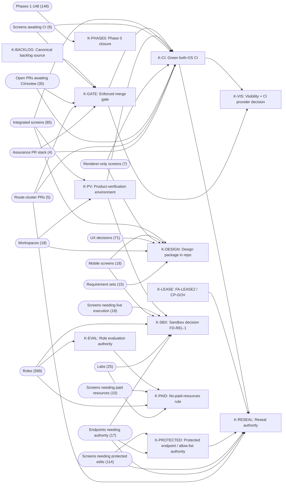

<!-- //TR: Bagimlilik haritasi: kilit taslar (CI, birlestirme kapisi + dal korumasi + onaylayici, FA-LEASE2/CP-GOV, yeniden muhurleme, backlog kaynagi, tasarim paketi) ve bagli is kalemleri / Dependency map with keystones -->

# Dependency map, 2026-10-19

`dependency-map.json` holds 137 nodes (13 keystones, 17 groups, 107 tasks) and 200 edges. Edge `A depends-on B` means A cannot complete until B is resolved; `K resolved-by T` names the task that resolves a keystone. Group sizes are counts of work items in their own dimension and are not additive across groups.

## Keystones

"Tasks" and "Groups" are the direct and transitive dependents. "Reach by dimension" counts the distinct dependent items in each dimension (deduplicated within a dimension, because the screen keyword groups overlap). The dimensions are never added together; an earlier cross-dimension "blocked items" sum was removed by the critic pass.

| Keystone | What must happen | Tasks | Groups | Reach by dimension (not summed) | Resolved by |
|---|---|---|---|---|---|
| K-VIS | Founder decision: repository visibility + CI provider (repo is PUBLIC now; directive says keep private + CircleCI Free) | 53 | G-PR-ASSURE, G-PR-PENDING, G-PR-ROUTE, G-SCR-DO, G-SCR-INV, G-SCR-PCI, G-WS | tasks 53; screens 101; workspaces 18; PRs 36 | PT-012, PT-007, PT-002 |
| K-CI | Green validate on ubuntu AND windows for a mergeable head (never achieved on Windows) | 48 | G-PR-ASSURE, G-PR-PENDING, G-PR-ROUTE, G-SCR-DO, G-SCR-INV, G-SCR-PCI, G-WS | tasks 48; screens 101; workspaces 18; PRs 36 | PT-001, PT-003, PT-004, PT-005, PT-007 |
| K-GATE | Enforced merge gate: coded gate (#11) + ruleset/branch protection + distinct approver identity | 36 | G-PR-ASSURE, G-PR-PENDING, G-PR-ROUTE, G-SCR-PCI | tasks 36; screens 9; PRs 36 | PT-021, PT-022, PT-023, PT-024 |
| K-LEASE | FA-LEASE2 D3 sealed record / CP-GOV separate-identity governance | 7 | - | tasks 7 | PT-026, PT-027, PT-028 |
| K-RESEAL | Trust-root reseal authority and serialization for protected-path changes | 65 | G-EP-AR, G-PR-ASSURE, G-PR-PENDING, G-PR-ROUTE, G-SCR-AR-PROTECTED, G-SCR-DO, G-SCR-INV, G-SCR-PCI, G-WS | tasks 65; screens 215; workspaces 18; endpoints 17; PRs 36 | PT-029 |
| K-BACKLOG | Canonical backlog source decision (PR #16 + Founder authority strings) | 5 | - | tasks 5 | PT-051 |
| K-DESIGN | 252-screen design package, UX-DEC-001..071, DEV/REL texts, SC blueprint available in repo (UNKNOWN_SOURCE today) | 4 | G-REQ, G-SCR-DO, G-SCR-INV, G-SCR-MOBILE, G-UX, G-WS | tasks 4; screens 110; workspaces 18; ux-decisions 71; requirement-sets 15 | no task: Founder action / external |
| K-PROTECTED | Founder FA-V2-PRODUCT authority for protected server.ts endpoints + main.mjs allow-list edits | 2 | G-EP-AR, G-SCR-AR-PROTECTED | tasks 2; screens 114; endpoints 17 | PT-035, PT-106 |
| K-SBX | Founder FD-REL-1 sandbox provider decision (no project-code execution today) | 1 | G-EP-AR, G-LABS, G-ROLES, G-SCR-AR-SBX, G-SCR-INV, G-SCR-MOBILE, G-WS | tasks 1; screens 113; workspaces 18; roles 599; labs 25; endpoints 17 | no task: Founder action / external |
| K-PV | Product-verification environment: real Electron + live backend + data protocol (none recorded) | 1 | G-SCR-INV, G-WS | tasks 1; screens 85; workspaces 18 | PT-015 |
| K-PHASE0 | Phase 0 closure: Founder detached signature + target-machine acceptance | 2 | G-PH | tasks 2; phases 148 | PT-094, PT-095 |
| K-PAID | No-paid-resources rule (blocks KMS/HSM, device farms, cloud labs, paid model evals) | 2 | G-LABS, G-ROLES, G-SCR-AR-PAID | tasks 2; screens 10; roles 599; labs 25 | PT-028 |
| K-EVAL | Role evaluation/certification authority (live model execution + independent evaluator) | 0 | G-ROLES | roles 599 | no task: Founder action / external |

The six keystones named by the task brief map as follows: Actions/CI = K-CI (+ K-VIS); merge gate + branch protection + approver = K-GATE; FA-LEASE2/CP-GOV = K-LEASE; reseal bottleneck = K-RESEAL; backlog source decision = K-BACKLOG; design package availability = K-DESIGN. K-PROTECTED, K-SBX, K-PV, K-PHASE0, K-PAID and K-EVAL are additional keystones found in the raw evidence.

## Groups

| Group | What | Items | Depends on |
|---|---|---|---|
| G-SCR-INV | Screens INTEGRATED_NOT_VERIFIED on v7 (wired, never product-verified) | 85 | K-PV, K-DESIGN, K-CI |
| G-SCR-PCI | Screens whose code is only on open PRs awaiting CI | 9 | K-CI, K-GATE |
| G-SCR-AR-PROTECTED | AUTHORITY_REQUIRED screens needing a new/changed protected endpoint or desktop allow-list entry | 114 | K-PROTECTED, K-RESEAL |
| G-SCR-AR-SBX | AUTHORITY_REQUIRED screens needing live execution (FD-REL-1 sandbox) | 18 | K-SBX |
| G-SCR-AR-PAID | AUTHORITY_REQUIRED screens needing paid resources or cost authority | 10 | K-PAID |
| G-SCR-MOBILE | Mobile companion screens (no mobile client in repo; no SC) | 18 | K-SBX, K-DESIGN |
| G-SCR-DO | DESIGN_ONLY screens buildable without new authority (renderer-only) | 7 | K-DESIGN, K-CI |
| G-UX | UX decisions UX-DEC-001..071 (texts on Founder PC) | 71 | K-DESIGN |
| G-WS | Desktop workspaces SC-01..SC-18 | 18 | K-DESIGN, K-PV |
| G-PH | Roadmap phases PH-001..PH-148 (formally gated by Phase 0) | 148 | K-PHASE0 |
| G-ROLES | 599 specialist roles (0 evaluated, 0 certified) | 599 | K-EVAL, K-PAID, K-SBX |
| G-LABS | Execution labs (24 of 25 not implemented) | 25 | K-SBX, K-PAID |
| G-EP-AR | Endpoints/IPC needing protected edits or sandbox (company writes, export bugs, dev-run, torn-tail repair) | 17 | K-PROTECTED, K-SBX, K-RESEAL |
| G-PR-PENDING | Open PRs whose code awaits CI or review | 35 | K-CI, K-GATE |
| G-PR-ROUTE | Route-cluster PRs that must merge strictly one at a time (#27 -> #28 -> #32 -> #33 -> #8) | 5 | K-CI, K-GATE, K-RESEAL |
| G-PR-ASSURE | Assurance stack #24 -> #25 -> #26 -> #41 | 4 | K-CI, K-GATE |
| G-REQ | Requirement sets DEV-001..116 and REL-117..216 (texts unknown) | 15 | K-DESIGN |

## Critical paths

| # | Path | Chain | Notes |
|---|---|---|---|
| 1 | Founder: visibility + CI provider (K-VIS) | PT-012 -> PT-007 or PT-002 | decides where CI runs, whether rulesets are available, whether #49 is admissible |
| 2 | Green both-OS CI (K-CI) | PT-004 + PT-005 -> PT-003 (or PT-007) -> PT-001 | needs K-RESEAL for the protected ci.yml/validation.json edits |
| 3 | Enforced gate (K-GATE) | PT-021 -> PT-022 -> PT-023, PT-024 | needs K-CI and K-VIS |
| 4 | Drain PR backlog | PT-016 (waves) + PT-030 (post-merge verification of #1-#10) | needs K-CI and K-GATE; route cluster serialised; #8 needs K-RESEAL |
| 5 | First product verification (K-PV) | PT-015 fix -> live-data protocol -> screens move from INTEGRATED_NOT_VERIFIED | needs K-CI; mission flows need K-SBX |
| 6 | Authority screens | K-PROTECTED batch (allow-list/endpoint edits) via PT-029 reseal | ~114 screens name a protected endpoint/allow-list |
| 7 | Autonomy | PT-051 (backlog) + PT-026 (FA-LEASE2) -> PT-039 dev routine, PT-050 dispatch, PT-053 72 h test | needs K-BACKLOG, K-LEASE, K-GATE |

## Keystone and group graph

## Facts behind the keystones

- **K-CI**: never green on Windows; `e12dbdd` red on both OSes; #49 red on both at `498e2eb`; 9 Windows steps fail in isolation; the Linux tests-2 hang depends on earlier steps.
- **K-VIS**: repo public (live), directive says private + CircleCI; branch protection was recorded as unavailable on the private Free plan (C6), so the visibility choice also decides whether K-GATE can be enforced for free.
- **K-GATE**: rulesets `[]`; `protected:false`; one identity; gate script only on #11 and hard-coded to GitHub contexts.
- **K-LEASE**: `refs/uasco/*` absent; FA-LEASE2 D3 record absent; CP-GOV Phase 1+ needs paid KMS (conflicts with K-PAID).
- **K-RESEAL**: needed by #8, #49, FA-LEASE2, the WFR-03 step, the 7 B2 test-gap tasks, B2-SBOM and the standalone-proof registration (`config/validation.json` is protected).
- **K-BACKLOG**: `BACKLOG_CHECKPOINT.json` exists only on PR #16 (head moved after BLOCKED); the Cloud Development routine exits BLOCKED each hour.
- **K-DESIGN**: all design content is UNKNOWN_SOURCE; parity cannot be checked for any of the 252 screens or 71 UX decisions.
- **K-PROTECTED**: `server.ts`, `main.mjs`, `preload.mjs`, `renderer/app.js` and `automation/lib/` are protected (`config/protected-paths.json:21-25,144`).
- **K-SBX**: `core/workos/execution-gate.ts` always returns SANDBOX_UNAVAILABLE (FD-REL-1); blocks dev-run, preview, project tests, mission COMPLETE and every lab.
- **K-PV**: no recorded real-desktop + live-backend run; #50 is the first harness (BLOCKED review).
- **K-PHASE0**: Founder detached signature + target-machine `PHASE0_ACCEPTANCE` pending; formally gates phases 1-148.
- **K-EVAL**: 0 of 3594 evaluation specs executed; no independent evaluator identity.
